# 〈라우럴! 볼륨 좀 올려〉 게임 기획서

**“앞줄은 떼창 중인데, 뒷줄은 후렴이 시작된 것도 모른다.”**

플레이어가 공연장의 음향을 맡아, 관객 반응을 보며 무대를 완성하는 **오프라인 스마트폰 게임**이에요. 한 공연은 3~5분이고, 여러 공연을 진행하면서 장비를 얻고 더 큰 무대를 열어요.

## 1. 핵심 플레이

세로 화면 위쪽에는 무대와 관객, 아래쪽에는 엄지로 움직이는 볼륨 슬라이더가 있어요. 첫 공연에서는 **앞줄과 뒷줄 볼륨** 두 개를 조절해요.

1. **관객을 본다.** 소리가 작으면 관객이 귀를 기울이고, 적당하면 박수를 치거나 따라 불러요. 너무 크면 귀를 막아요.
2. **구역별 볼륨을 조절한다.** 앞줄이 이미 들썩이면 그대로 두고, 잘 안 들리는 뒷줄만 올려요. 관객 표정과 아이콘으로 소리를 끈 상태에서도 반응을 읽을 수 있어요.
3. **“라우럴!” 신호에 맞춰 후렴을 살린다.** 무대 위 캐릭터가 외치면 잠시 뒤 후렴이 시작돼요. 그때 만족한 관객이 많을수록 떼창이 커지고 점수를 얻어요. 볼륨을 너무 올려 하울링이 나면, 바로 낮춰 다음 후렴에서 만회할 수 있어요.

**플레이 예시.** 동네 축제 첫 후렴에서 앞줄만 따라 불러요. 두 번째 후렴 직전에 뒷줄 볼륨을 올리자, 멀뚱히 있던 관객이 박수를 치기 시작해요. 마지막 후렴에 두 구역이 동시에 떼창하고, 무대 옆 푸드트럭 사장님까지 집게를 들고 박자를 맞춰요.

## 2. 공연을 이어가는 재미

**공연 선택 → 음향 조절 → 결과와 보상 → 장비 선택 → 다음 공연**으로 진행해요. 결과 화면에는 점수와 함께 **어느 구역이 언제 떼창에 합류했는지** 보여줘서 다음 판에서 바꿔볼 게 생겨요.

| 공연장 | 새로 생기는 판단 |
|---|---|
| **동네 축제** | 앞줄과 뒷줄 반응을 읽고 두 구역을 떼창에 합류시켜요. |
| **지하 라이브클럽** | 관객과 스피커가 가까워서, 볼륨을 조금만 과하게 올려도 관객이 귀를 막아요. |
| **야외 야시장** | 푸드트럭 발전기가 켜질 때 옆 구역의 반응이 달라져서 공연 도중에 조절해야 해요. |

공연 보상으로 장비를 열고, 다음 무대에 가져갈 장비를 골라요. 예를 들어 **뒷줄 스피커**는 먼 관객에게 소리를 더 잘 전달하고, **리미터**는 볼륨을 급하게 올렸을 때 관객이 놀라는 상황을 줄여줘요. 어떤 장비가 유리한지는 공연장마다 달라요.

## 3. 첫 제작 범위

| 항목 | 첫 버전 |
|---|---|
| **공연** | 동네 축제 1곳, 자체 음악 1곡, 약 3분 |
| **조작** | 앞줄·뒷줄 볼륨 슬라이더, “라우럴!” 신호 |
| **관객 반응** | 귀 기울이기, 박수, 떼창, 귀 막기 |
| **결과** | 공연 점수, 구역별 떼창 성공 횟수, 기기 내 최고 기록 |
| **오프라인** | 음악과 효과음을 앱에 포함하고, 기록과 진행 상황은 스마트폰에 저장 |

첫 버전에서는 **“라우럴!”이 들리면 무작정 볼륨을 올리고 싶다가도, 관객을 보고 어느 쪽을 올릴지 고민하게 되는지**를 확인해요. 첫 공연이 끝난 사람이 결과를 보고 *“이번엔 뒷줄도 떼창시킬 수 있겠다”*며 한 번 더 누르면, 공연장과 장비를 확장할 이유가 생겨요.

## 4. 첫 공연 상세 — 동네 축제

**목표는 세 번의 후렴에서 앞줄과 뒷줄을 떼창에 합류시키는 것**이에요. 공연마다 소리 전달 조건이 달라지고, 첫 공연에서는 그 차이를 한 번에 하나씩 보여줘요.

| 공연 시간 | 무대에서 일어나는 일 | 플레이어가 알아차릴 것 |
|---|---|---|
| 0:00–0:25 | 리허설. 앞줄은 박수를 치고 뒷줄은 귀를 기울여요. | 뒷줄을 올리면 뒷줄 반응이 크게 바뀌고, 앞줄 반응도 조금 바뀔 수 있어요. |
| 0:25–1:05 | 본공연 시작. “라우럴!” 사인과 첫 후렴이 나와요. | 외침이 나오면 현재 관객 반응을 확인하고 후렴을 준비해요. |
| 1:05–1:55 | 앞줄 가까이에 관객이 몰려요. 앞줄의 적정 볼륨이 내려가고 두 번째 후렴이 와요. | 분위기를 살리려면 앞줄 볼륨을 조금 내려야 할 수도 있어요. |
| 1:55–3:00 | 푸드트럭 발전기 소리 때문에 뒷줄이 다시 귀를 기울여요. 마지막 후렴에서 두 구역이 떼창하면 사장님도 박자를 타요. | 뒷줄을 다시 맞추고 앞줄의 떼창을 유지해요. |

## 5. 조작과 판정

- **슬라이더는 앞줄과 뒷줄에 하나씩** 있어요. 드래그하면 두 구역의 실제로 들리는 볼륨을 계산하고, 관객의 표정과 아이콘을 갱신해요. 볼륨이 낮으면 귀 기울이기, 적정하면 박수, 과하면 귀 막기예요. 적정 볼륨 범위는 관객 반응으로 찾을 수 있어요.
- **기본안에서는 “라우럴!”이 후렴 3초 전 신호**예요. 플레이어가 직접 신호를 보내는 개선안과 적용 순서는 9절에 정리해요.
- **각 후렴의 첫 10초가 득점 구간**이에요. 적정 볼륨인 구역마다 초당 1점, 두 구역이 동시에 적정하면 초당 보너스 1점을 얻어요. 구간 중간에도 떼창에 합류하거나 빠질 수 있어요. 세 후렴의 최고점은 90점이에요. 화면에는 정수 점수를 표시하고 소수점 이하는 버려요.
- **슬라이더는 게임 속 구역 음향을 조절**해요. 스마트폰 자체 볼륨은 그대로 두고, 하울링은 아이콘과 짧은 효과음으로 표현해요.
- **잠시 자리를 비우면 공연도 정지**해요. 일시정지 메뉴에서 이어 하거나 처음부터 다시 시작할 수 있어요.

## 6. 공연 결과와 다음 무대

결과 화면에는 **공연 점수(90점 만점), 후렴별 앞줄·뒷줄 떼창 시간, 두 구역 동시 떼창 시간**을 표시해요. 예를 들어 마지막 후렴에 뒷줄이 4초 늦게 들어왔다면 그 구간을 보여줘요. 최고 점수와 도전 목표 달성 여부는 기기에 저장하고, 결과 화면에서 같은 무대에 바로 재도전할 수 있어요.

공연장을 확장하면 **60/90점**을 다음 공연장 해금 기준으로 시험해요. 장비 없이도 공연 중 발생하는 모든 상황에서 두 구역의 적정 볼륨을 동시에 맞출 수 있어야 해요.

## 7. 재미 개선 적용 순서

| 순서 | 구현 내용 | 확인할 플레이 |
|---|---|---|
| 1. 구역 간 소리 전달 | 각 슬라이더가 반대 구역에도 영향을 주게 해요. 초기값은 반대 구역에 조절량의 20%를 더하는 방식으로 시험해요. 예를 들어 뒷줄을 10 올리면 앞줄에도 2가 전달돼요. | 처음엔 뒷줄만 올린 플레이어가 앞줄의 귀 막기 반응을 보고 앞줄을 내려 두 구역을 회복해요. |
| 2. 후렴 중 합류와 득점 | 후렴 10초 동안 적정 상태로 보낸 시간을 누적하고, 두 구역이 함께 부르면 보너스를 줘요. 결과 화면에도 같은 기록을 표시해요. | 후렴 시작을 놓쳐도 바로 조작을 이어가고, 재도전할 때 이전보다 오래 떼창을 유지해요. |
| 3. 돌발 상황 예고 | 마지막 후렴 전에 푸드트럭 사장님이 발전기 쪽으로 걸어가고, 작동 직전에 발전기 아이콘을 표시해요. 발전기가 켜지면 뒷줄에서 들리는 공연 소리가 상대적으로 작아져요. | 처음에는 사건을 보고 대응하고, 재도전할 때는 예고를 보고 조절할 준비를 해요. |
| 4. 떼창 연출 | 두 구역이 동시에 떼창하면 박수가 객석 뒤까지 번져요. 마지막 후렴에 두 구역이 3초 연속 떼창하면 푸드트럭 사장님도 집게로 박자를 맞춰요. | 무음 상태에서도 두 구역이 함께 부르기 시작한 순간을 알아차려요. |
| 5. 재도전 목표 | 같은 무대에 ‘하울링 없이 완주’와 ‘마지막 후렴 뒷줄 8초 연속 떼창’ 목표를 추가해요. 공연 최고점과 별도로 달성 여부를 저장해요. | 플레이어가 점수와 별개로 목표를 선택하고, 목표에 따라 슬라이더를 다르게 다뤄요. |

첫 플레이테스트는 **1~2단계까지 구현한 동네 축제 한 무대**로 진행해요. 조작 설명을 보지 않고도 반대 구역의 반응을 이해하는지, 늦게라도 떼창을 살릴 수 있다는 걸 알아차리는지, 결과 화면에서 재도전을 누르는지 관찰해요. 3~5단계를 추가한 뒤 같은 흐름을 다시 확인해요. 20% 전달량, 득점 10초, 목표 8초, 해금 60점은 모두 테스트용 초기값이에요.

## 8. 재미 점수 재평가

아래 점수는 기존과 같은 다섯 항목으로 비교한 **기획 평가**예요. 실제 재미는 첫 플레이테스트를 통해 확인해요.

| 평가 항목 | 개선 전 | 1~2단계 적용안 | 1~5단계 적용안 | 변동 근거 |
|---|---:|---:|---:|---|
| 첫인상과 콘셉트 | 16/20 | 16/20 | 17/20 | 관객석을 따라 번지는 떼창이 게임의 목표를 한 장면으로 보여줘요. |
| 조작과 반응 | 14/20 | 16/20 | 17/20 | 두 구역이 반응하고, 떼창을 회복한 순간이 조작 직후 드러나요. |
| 판단의 깊이 | 10/20 | 16/20 | 16/20 | 반대 구역에 미칠 영향을 보며 두 슬라이더를 함께 조절해요. |
| 공연의 리듬 | 11/20 | 15/20 | 16/20 | 후렴 도중에도 득점할 수 있고, 사건 예고가 후렴 사이에 할 일을 만들어요. |
| 다시 할 이유 | 9/20 | 12/20 | 14/20 | 떼창 시간에 기록 차이가 생기고, 별도 목표로 같은 무대를 다르게 플레이해요. |
| **합계** | **60/100** | **75/100** | **80/100** | |

가장 큰 변화를 만드는 건 **한쪽을 살리면 다른 쪽이 흔들리는 조작**이에요. 이 반응을 플레이어가 화면에서 이해하고, 후렴 도중 다시 균형을 잡는 순간에 재미를 느끼는지가 평가를 좌우해요.

## 9. 플레이어가 만드는 ‘라우럴!’ — 적용 절차

1~2단계는 동네 축제의 후렴 하나로 검증해요. 통과하면 같은 규칙을 첫 공연의 세 후렴에 적용하고, 3단계부터 결과 화면과 다른 공연장으로 확장해요.

| 단계 | 구현할 내용 | 다음 단계로 넘어가기 전에 확인할 행동 |
|---|---|---|
| 1. 직접 신호 보내기 | 후렴 직전 4박에 앞줄·뒷줄 신호 버튼을 열어요. 플레이어가 한 구역을 골라 ‘라우럴!’을 보내면 다음 박에 그 구역의 떼창이 시작돼요. 박자 표시는 무음에서도 보여요. | 플레이어가 먼저 준비된 구역을 찾아 신호를 보내고, 어느 구역이 먼저 부를지 예상해요. |
| 2. 떼창 전달과 회복 | 첫 구역이 2박 동안 떼창을 유지하면 반대 구역에 받아 부를 기회가 생겨요. 너무 빨리 보내면 한 구역만 부를 수 있고, 반대 구역을 맞추면 뒤늦게 합류할 수 있어요. | 플레이어가 즉시 한 구역에서 시작할 때와 한 박 기다려 두 구역을 준비할 때를 스스로 구분해요. |
| 3. 하이라이트와 재도전 | 종료 후 동시 떼창 시간이 가장 긴 후렴의 8초를 기기에서 재생해요. ‘이 후렴 다시 도전’은 직전 볼륨과 사건 시점으로 돌아가 같은 조건에서 다시 시작해요. | 플레이어가 재생을 보고 언제 손을 움직일지 짚고, 같은 후렴에서 다른 시작 구역이나 타이밍을 시험해요. |
| 4. 공연장별 기술 | 라이브클럽에서는 무대 음량을 잠깐 내려 관객 목소리를 드러내고 다음 마디에 다시 올려요. 야시장에서는 소음이 덜한 구역부터 떼창을 시작하고, 소음이 잦아든 쪽을 합류시켜요. | 플레이어가 공연장을 바꾸면 신호를 보내는 순서나 볼륨을 조절하는 방식을 실제로 바꿔요. |

### 신호와 득점 규칙

- **신호는 후렴당 한 번** 보낼 수 있어요. 선택한 구역이 시작 박에 적정 볼륨이면 바로 떼창하고, 적정 범위 밖이면 준비되지 않았다는 반응을 보여줘요.
- 시작 구역이 2박 동안 적정 볼륨을 유지하면 떼창이 다른 구역으로 넘어갈 준비가 돼요. 반대 구역이 적정 볼륨에 들어오면 다음 박에 합류해요. 시작 신호를 놓치거나 시작 구역이 준비되지 않았어도 후렴 중에는 관객이 볼륨에 맞춰 일반 떼창에 합류할 수 있어요.
- **기존의 초당 구역 점수와 동시 떼창 보너스**를 유지해요. 직접 신호로 먼저 한 구역을 살리면 그 시간부터 기본 점수를 확보할 수 있고, 두 구역을 준비하면 동시 보너스를 더 오래 받을 수 있어요. 공연 점수는 후렴당 30점, 전체 90점 만점이에요.
- 후렴 단독 재도전은 해당 후렴의 기록으로 기기에 저장해요. 공연 전체 점수와 공연장 해금은 처음부터 끝까지 진행한 공연 결과로 판정해요.

4박 선택 구간, 2박 전달 조건, 8초 재생 길이는 첫 테스트용 초기값이에요. 첫 테스트에는 **앞줄부터 시작하면 안정적인 배치**와 **한 박 기다려 뒷줄부터 시작하면 유리한 배치**를 각각 넣어요. 화면을 켜되 소리는 끈 상태에서도 선택 구간과 떼창 전달을 읽을 수 있는지 확인해요.

## 10. 재미 점수 재평가 — ‘라우럴!’ 직접 보내기

| 평가 항목 | 이전 개선안 | 현재 설계 | 목표 | 평가 근거 |
|---|---:|---:|---:|---|
| 첫인상과 콘셉트 | 17/20 | 19/20 | 19/20 | 신호 하나로 떼창이 객석을 건너는 장면에서 게임의 목표가 바로 드러나요. |
| 조작과 반응 | 17/20 | 18/20 | 19/20 | 볼륨을 준비한 결과가 한 번의 탭으로 나오지만, 두 슬라이더와 박자 신호를 함께 읽기 쉬운지는 검증이 필요해요. |
| 판단의 깊이 | 16/20 | 18/20 | 19/20 | 기다릴지 먼저 시작할지 선택이 생겨요. 한쪽부터 보내는 전략만 반복해도 높은 점수가 나오는지는 확인해야 해요. |
| 공연의 리듬 | 16/20 | 18/20 | 19/20 | 준비, 신호, 응답 흐름이 명확해져요. 후렴이 세 번 있는 전체 공연에서도 긴장감이 이어지는지는 확인해야 해요. |
| 다시 할 이유 | 14/20 | 17/20 | 19/20 | 방금 놓친 후렴을 바로 다시 할 수 있어요. 공연장별 기술이 실제로 조작을 바꾸고 다음 무대를 열고 싶게 하는지는 검증이 필요해요. |
| **합계** | **80/100** | **90/100** | **95/100** | 현재 점수는 설계 평가예요. |

목표인 95점으로 평가를 올릴 근거는 플레이테스트에서 찾아요. 설명 없이 신호를 보낼 때를 알아보고, 조건이 달라지면 시작 구역과 타이밍을 바꾸고, 결과를 본 뒤 스스로 재도전하는지 먼저 확인해요. 이후 다른 공연장에서도 같은 조작 순서를 반복하는지 살펴봐요.

## 11. 95점 설계안 — 내가 시작하는 떼창

다음 프로토타입에는 이 절의 공연 길이와 후렴 규칙을 적용해요. **한쪽 관객에게 노래를 건네고, 다른 쪽이 받아 부르도록 만드는 것**이 한 후렴의 목표예요.

### 조작과 득점

1. **준비.** 화면 아래 앞줄·뒷줄 카드에 각각 볼륨 슬라이더와 관객 반응을 모아요. 귀 기울이기, 박수, 귀 막기로 상태를 보여줘요. 두 구역의 소리는 조금씩 섞여요.
2. **시작.** 후렴 직전 네 박에 각 카드에 ‘라우럴!’ 버튼이 열려요. 남은 박은 화면에 표시해요. 준비된 구역을 누르면 다음 박에 그쪽부터 노래를 시작해요. 신호는 후렴당 한 번이에요.
3. **받아치기.** 먼저 부른 구역이 두 박을 버티면 반대 카드에 응답 표시가 나와요. 그 구역을 적정 볼륨에 맞추면 다음 박에 합류해요. 신호를 놓쳐도 후렴 3초 뒤에는 적정 볼륨인 구역부터 일반 떼창에 합류할 수 있어요.
4. **득점.** 후렴 첫 10초 동안 부르는 구역마다 초당 1점, 양쪽이 함께 부를 때 초당 1점을 더해요. 세 후렴 합계 90점 만점이에요. 100점 만점 재미 평가와는 별개의 공연 점수예요.

### 첫 공연 — 약 100초, 세 번의 선택

| 공연 시간 | 상황 | 유리한 판단 |
|---|---|---|
| 0–20초 | 리허설. 뒷줄 슬라이더를 올리면 앞줄 관객도 반응해요. | 슬라이더와 관객 반응의 관계를 익혀요. |
| 20–45초 | 첫 후렴. 앞줄이 준비됐고 뒷줄은 한 번 조절하면 따라올 수 있어요. | 앞줄로 바로 시작해 기본 점수를 확보하고 뒷줄을 합류시켜요. |
| 45–70초 | 두 번째 후렴. 앞줄에 관객이 몰려 기존 볼륨이 과해지고 뒷줄이 준비돼 있어요. | 뒷줄부터 시작하고 앞줄 볼륨을 내려 받아치게 해요. |
| 70–100초 | 마지막 후렴. 발전기 소음이 뒷줄을 가리고, 꺼질 시점은 박자 표시에 예고돼요. | 앞줄부터 일찍 시작하거나 소음이 잦아드는 박까지 기다려 양쪽 떼창을 노려요. |

마지막 후렴은 **일찍 벌어 둔 한 구역 점수**와 **늦게 시작해 얻는 동시 떼창 보너스**가 모두 경쟁력 있도록 조정해요. 발전기 정지 시점과 각 구역의 적정 범위를 바꿔 두 경로를 비교하고, 한쪽이 항상 이기면 수치를 다시 잡아요.

### 재도전과 다음 공연장

결과 화면에 후렴별로 **시작 구역, 상대가 들어온 박, 함께 부른 시간**을 보여줘요. 가장 오래 이어진 떼창의 8초를 재생하고, 놓친 후렴을 누르면 같은 슬라이더 값과 사건 시점으로 돌아가요. 후렴 연습과 전체 공연 기록은 기기에 각각 저장해요.

동네 축제에서 구역을 건너 떼창을 만드는 법을 익힌 다음, 라이브클럽에서는 반주를 한 마디 내려 관객 목소리를 살리는 기술을 배워요. 야시장에서는 소음이 잦아드는 박을 골라 신호를 보내요. 각 공연장의 첫 도전에서는 새 기술을 하나씩 익히고, 이후 목표에서 앞서 배운 기술과 조합해요.

### 구현과 검증 순서

| 순서 | 구현 | 확인할 행동 |
|---|---|---|
| 1 | 두 구역 카드와 신호·응답이 있는 후렴 하나 | 소리를 끈 상태에서도 별도 설명 없이 준비된 구역에 신호를 보내고 상대 구역을 합류시켜요. |
| 2 | 서로 다른 조건의 후렴 세 개와 100초 공연 | 플레이어가 첫 두 후렴에서 시작 구역을 바꾸고, 마지막 후렴에서는 두 시작 전략을 모두 시도해요. |
| 3 | 결과 막대, 8초 재생, 후렴 재도전 | 결과를 보고 놓친 후렴을 찾아 다른 타이밍으로 자발적으로 다시 해요. |
| 4 | 라이브클럽과 야시장의 새 기술 | 새 공연장에서는 관객 반응과 사건에 맞춰 조작 순서를 바꿔요. |

## 12. 재미 점수 재평가

| 항목 | 이전 설계 | 새 설계 | 반영한 변경 |
|---|---:|---:|---|
| 첫인상과 콘셉트 | 19 | 19 | ‘라우럴!’로 객석 사이에 떼창을 전달해요. |
| 조작과 반응 | 18 | 19 | 구역 카드 하나에서 볼륨, 준비 상태, 박자 신호를 읽어요. |
| 판단의 깊이 | 18 | 19 | 상황에 따라 시작 구역과 기다릴 시간이 달라져요. |
| 공연의 리듬 | 18 | 19 | 약 100초에 서로 다른 후렴 세 번을 배치해요. |
| 다시 할 이유 | 17 | 19 | 같은 조건에서 후렴을 즉시 다시 해보고, 공연장마다 기술이 하나씩 늘어요. |
| **합계** | **90/100** | **95/100** | 플레이테스트 전 설계 평가예요. |

100초 공연과 네 박 신호 구간은 초기값이에요. 무음에서도 신호를 이해하는지, 매번 같은 구역과 박을 골라도 높은 점수가 나오는지, 결과를 보고 실제로 재도전하는지를 확인한 뒤 수치와 평가를 갱신해요.

## 13. 레벨 디자인 — 세 공연에서 배우는 세 가지 기술

다음 프로토타입의 공연별 후렴 배치와 해금 기준은 이 절을 적용해요. 세 무대 모두 **첫 후렴에서 기술을 알아차리고, 두 번째에서 조건을 바꿔 써보고, 마지막에서 앞서 배운 기술과 조합**해요. 새 기술은 후렴 전 몇 박 동안 점수 없이 한 번 연습할 수 있어요.

| 무대와 학습 목표 | 첫 후렴 | 두 번째 후렴 | 마지막 후렴 |
|---|---|---|---|
| **동네 축제 · 시작 구역 선택** | 앞줄이 먼저 준비돼요. 앞줄 신호를 보내고 뒷줄을 합류시켜요. | 앞줄 관객이 스피커 가까이 몰려요. 준비된 뒷줄부터 시작한 뒤 앞줄 볼륨을 내려 합류시켜요. | 발전기 소음으로 뒷줄이 늦게 준비돼요. 앞줄에서 먼저 구역 점수를 확보하거나, 소음이 잦아들 때 양쪽 떼창을 노려요. |
| **라이브클럽 · 반주를 비워 주기** | 보컬이 마이크를 관객에게 돌리면 네 박 동안 반주를 내리는 버튼이 열려요. 반주를 내리면 이미 준비된 앞줄 관객이 받아 불러요. | 뒷줄이 먼저 준비돼요. 네 박을 다 쓰면 곡이 돌아오는 첫 박이 비므로, 뒷줄이 두 박을 채운 뒤 복귀 버튼을 눌러 다음 박에 반주를 돌려요. | 뒷줄부터 떼창을 시작하고 앞줄이 받아 불러요. 반주를 너무 일찍 올리면 응답이 묻히고, 너무 늦으면 복귀 점수를 놓쳐요. |
| **야시장 · 소음이 비는 박 찾기** | 발전기가 4박 동안 돌아가고 4박 동안 조용해져요. 조용해지는 첫 박에 뒷줄이 듣기 시작해요. | 소음이 비는 시간이 2박으로 줄어요. 소음 영향이 적은 앞줄을 먼저 살리고, 조용해지는 박에 뒷줄을 합류시켜요. | 뒷줄이 조용해지는 시점과 반주 복귀 박이 가까워요. 앞줄 신호를 예약하고, 반주를 잠깐 내려 뒷줄의 응답을 드러낸 뒤 곡을 복귀시켜요. |

### 2.5D 도트로 보여주는 단서

- **객석 위치.** 고정 카메라에서 무대와 앞줄·뒷줄을 분리해 보여줘요. 조작 카드의 구역 아이콘을 객석에도 붙이고, 떼창을 시작한 쪽에서 상대 구역으로 손 드는 동작과 조명이 순서대로 번져요.
- **원인과 시점.** 가까이 몰려드는 관객, 관객에게 방향을 돌리는 마이크, 작동 중 흔들리는 발전기를 먼저 보여줘요. 그다음 변화가 일어날 구역 카드에 남은 박을 표시해요. 자세와 아이콘도 함께 바뀌어 색이나 소리 없이 읽을 수 있어요.
- **실패와 회복.** 볼륨이 과하면 해당 관객이 귀를 막고, 반주 복귀가 늦으면 박자 띠에 빈 구간이 보여요. 볼륨을 다시 맞추면 다음 박부터 합류할 수 있어요. 필수 단서와 관객 반응은 작은 세로 화면에서도 동시에 보여야 해요.

### 난이도, 해금과 숙련 목표

- **해금.** 각 공연을 48/90점으로 마치면 다음 공연장을 열어요. 라이브클럽과 야시장의 무대 기술은 일반 떼창으로도 얻을 수 있는 점수에 더해, 후렴마다 최대 2점의 기술 점수를 줘요. 기술이 있는 무대는 후렴당 떼창 점수를 최대 28점으로 제한해 전체 90점을 유지해요. 라이브클럽은 두 박 이상 관객 목소리를 살리고 지정 박에 복귀하면 2점, 야시장은 조용해지는 첫 박이나 다음 박에 해당 구역을 합류시키면 2점이에요. 점수 배분과 해금 기준은 초기값이에요.
- **숙련 도전.** 완주한 무대마다 한 가지 조건만 바꾼 도전을 열어요. 동네 축제는 두 번째 후렴의 관객 몰림을 뒷줄로 옮겨요. 라이브클럽은 복귀 박을 한 박 앞당겨요. 야시장은 두 번째 후렴의 소음 정지 시점을 한 박 늦춰요. 달라진 조건은 무대에서 예고하고, 같은 도전에서는 매번 같은 시점에 발생해요.
- **후렴 연습.** 결과 화면에서 놓친 후렴을 눌러 같은 조건으로 다시 할 수 있어요. 직전 시도와 비교해 시작 박, 양쪽 떼창 시간, 기술 점수를 보여줘요. 공연 해금은 전체 공연 기록으로 판정하고, 숙련 도전과 연습 기록도 기기에 저장해요.

### 제작 순서와 통과 기준

1. **동네 축제.** 무음 상태 첫 플레이에서 앞줄·뒷줄을 헷갈리는지 관찰해요. 첫 두 후렴에서 다른 시작 구역을 고르는지, 마지막 후렴의 두 접근이 비슷한 점수를 낼 수 있는지 비교해요.
2. **라이브클럽.** 첫 후렴에서 반주를 내리고, 두 번째에서 올릴 박을 고르고, 세 번째에서 구역 전환과 조합하는지 확인해요. 첫 실수 직후에도 반주를 되돌리고 떼창을 회복할 수 있어야 해요.
3. **야시장.** 4박과 2박의 소음 공백을 구분하는지, 마지막 후렴에서 배운 기술을 함께 사용하는지 확인해요. 배경 연출을 줄인 작은 화면에서도 예고가 보여야 해요.
4. **숙련 도전.** 한 번 클리어한 플레이어가 바뀐 조건을 읽고 조작을 바꾸는지 확인해요. 첫 테스트에서는 각 공연장의 일반 후렴과 숙련 배치 한 개만 비교해요.

## 14. 레벨 디자인 재평가

| 항목 | 기존 | 변경 후 | 변경 근거 |
|---|---:|---:|---|
| 첫 무대의 학습 흐름 | 18 | 19 | 새 기술을 손해 없이 먼저 써보고 후렴에 적용해요. |
| 후렴별 선택 | 18 | 19 | 시작 구역, 반주 복귀 박, 소음 공백이 후렴마다 다른 결정을 만들어요. |
| 상황과 타이밍 전달 | 17 | 19 | 도트 캐릭터의 동작으로 원인을 보여주고 구역 카드에서 시점을 읽어요. |
| 공연장별 난이도와 진행 | 15 | 20 | 새 기술의 소개·응용·조합을 세 무대의 아홉 후렴에 배치해요. |
| 재도전과 숙련 | 16 | 19 | 동일 조건 연습과 조건을 한 가지 바꾼 숙련 도전으로 복습과 응용을 구성해요. |
| **합계** | **84/100** | **96/100** | 플레이테스트 전 레벨 디자인 평가예요. |

96점의 검증 기준은 각 공연의 마지막 후렴에서 플레이어가 **무대의 예고를 읽고, 앞서 배운 기술을 스스로 꺼내 쓰는지**예요. 마지막 후렴을 한 가지 고정 순서로 쉽게 통과하거나 기술의 실패 원인을 화면에서 알 수 없다면, 해당 후렴을 먼저 조정해요.

## 15. 밸런스 설계 — 96점 기준안

이 절의 득점, 공연장 해금, 타이밍 기준을 다음 프로토타입에 적용해요. 공연 만점은 90점으로 유지해요.

### 후렴 점수와 전략 비교

후렴의 첫 10초 동안 **앞줄 떼창 시간 + 뒷줄 떼창 시간 + 동시 떼창 시간**을 초 단위로 더해 기본점을 계산해요. 기본점은 최대 30점이고, 소수점은 전체 공연 점수를 합산한 뒤 표시할 때만 버려요.

| 무대 | 후렴 점수 |
|---|---|
| 동네 축제 | 기본점 그대로, 최대 30점 |
| 라이브클럽·야시장 | 기본점에 0.8을 곱하고 기술 점수 최대 6점을 더해 최대 30점 |

기술 점수는 **준비·실행·마무리 각 2점**으로 나눠요. 라이브클럽은 반주를 내려 관객에게 마이크를 넘기기, 관객 떼창을 두 박 드러내기, 복귀 박에 맞추기예요. 야시장은 소음이 적은 쪽부터 시작하기, 조용해진 구역을 다음 박까지 합류시키기, 양쪽 떼창을 두 박 유지하기예요. 단계는 앞에서부터 달성하고, 복귀나 유지에 실패해도 이미 얻은 기술 점수는 남아요.

동네 축제 마지막 후렴의 첫 튜닝 목표는 다음과 같아요. 아래는 **예상 플레이 결과의 계산 예시**이며, 실제 조작 로그로 재현되는지 확인해요.

| 선택 | 성공 시 | 상대 구역 합류가 늦었을 때 |
|---|---:|---:|
| 앞줄부터 바로 시작 | 앞줄 9초 + 뒷줄 6초 + 동시 6초 = **21점** | 9 + 5 + 5 = **19점** |
| 한 박 기다려 양쪽 떼창 준비 | 앞줄 8초 + 뒷줄 8초 + 동시 8초 = **24점** | 8 + 5 + 5 = **18점** |

기다리기는 성공하면 3점 더 받고, 합류가 늦으면 즉시 시작보다 1점 낮아요. 반대로 발전기 공백이 짧은 숙련 배치에서는 즉시 시작이 성공 기준으로도 더 높게 나오도록 조정해요. 각 배치의 사건 시점은 고정해 같은 선택을 반복하면 같은 결과를 얻을 수 있게 해요.

### 입력과 실수 회복

- 신호 구간은 **네 박과 2초 중 더 긴 시간** 동안 열어요. 버튼 입력은 다음 박에 예약되고 화면에 예약 상태가 보여요. 예약된 신호는 같은 후렴에서 중복 입력되지 않아요.
- 라이브클럽의 복귀는 목표 박보다 최대 한 박 일찍 예약할 수 있어요. 목표 박을 놓치고 바로 다음 박에 복귀하면 마무리 점수 2점 중 1점을 줘요.
- 야시장에서는 시끄러운 동안에도 뒷줄 볼륨을 미리 맞출 수 있어요. 조용해지면 준비된 관객은 다음 박까지 자동 합류하므로 두 박 공백 안에 슬라이더와 신호를 연달아 눌러야 하는 상황을 줄여요.
- 신호 실패 시 3초 뒤 일반 떼창을 시작할 수 있어요. 볼륨을 맞추면 다음 박부터 회복하고 이미 얻은 점수는 유지해요. 적정 범위 안에서는 작은 슬라이더 움직임에 떼창이 끊겼다 이어지지 않도록, 이탈 판정에 슬라이더 눈금 2칸의 여유를 줘요.

### 진행 기준과 조정 순서

- **45/90점**이면 다음 공연장을 열어요. 세 후렴에서 각각 양쪽 떼창을 5초씩 유지하면 기술 점수 없이 동네 축제 해금 기준에 도달해요. 기술 점수가 있는 무대에서는 같은 플레이가 36점이므로, 기술 단계 달성이나 더 긴 떼창으로 남은 점수를 채워요. 마지막 후렴을 통째로 놓쳐도 이전 두 후렴으로 45점에 도달할 수 있어요.
- **72/90점**은 숙련 목표로 사용해요. 해금과 숙련 기록은 전체 공연으로 계산하고, 후렴 단독 연습 기록은 별도로 저장해요.
- 첫 검증에서는 같은 후렴에서 즉시 시작과 기다리기를 모두 기록하고, 각 전략에 신호 지연과 구역 합류 지연을 한 번씩 넣어 점수 손실을 비교해요. 한 전략이 성공과 실수 양쪽에서 계속 앞서면 사건 타이밍과 구역 볼륨을 먼저 조정해요.
- 그다음 무음과 일반 모드에서 신호 누락, 복귀 실패, 해금 도달 여부를 확인해요. 의도한 전략을 읽었는데 입력만 놓친다면 예약 시간을 조정하고, 정상적으로 구역을 살렸는데도 초반 해금에서 막히면 기준 점수를 조정해요.

## 16. 밸런스 디자인 재평가

| 평가 항목 | 이전 | 변경 후 | 근거 |
|---|---:|---:|---|
| 전략 간 균형 | 15 | 19 | 성공·회복 점수의 교차 사례를 정의하고 유리한 전략이 바뀌는 배치를 추가했어요. |
| 점수와 보상 | 15 | 19 | 기술을 최대 6점으로 올리고 부분 성공을 보상해요. |
| 난이도와 해금 | 16 | 19 | 진행 기준과 숙련 목표를 나누고 한 후렴을 놓쳐도 통과 가능한 구조를 잡았어요. |
| 실수 후 회복 | 18 | 20 | 후렴 중 재합류, 점수 유지, 늦은 복귀 부분 점수를 제공해요. |
| 조작 타이밍의 여유 | 14 | 19 | 최소 선택 시간, 입력 예약, 소음 공백 자동 합류를 적용해요. |
| **합계** | **78/100** | **96/100** | 수치와 판정 규칙을 갖춘 기획안 평가예요. |

45점과 72점, 기술 점수 배분, 2초 입력 구간은 테스트용 초기값이에요. 실제 전략별 점수 분포와 첫 플레이 해금률은 구현 후 확인해요.

## 17. UX/UI 설계 — 세로 화면, 한 손 조작

### 공연 화면

| 위치 | 화면에 표시하는 내용 |
|---|---|
| 상단 | 남은 공연 시간과 일시정지. 후렴 번호는 전환 시 보여줘요. |
| 중앙 | 2.5D 도트 무대와 관객. 앞줄·뒷줄 이름과 구역 아이콘을 실제 객석 위치에 붙여요. |
| 하단 | 왼쪽은 앞줄, 오른쪽은 뒷줄 카드예요. 카드마다 구역 상태, 볼륨 슬라이더, ‘라우럴!’ 버튼을 같은 위치에 둬요. 무대 이벤트로 첫 행동이 필요한 카드에는 짧은 예고와 남은 박을 보여줘요. |

슬라이더와 신호 버튼을 세로로 분리하고, 신호 버튼은 카드 아래쪽의 고정 위치에 둬요. 처음부터 버튼 자리를 확보해 신호가 열려도 슬라이더가 움직이지 않아요. 버튼과 슬라이더의 터치 영역은 겹치지 않으며 최소 48 논리 픽셀 높이에서 시작해요. 카드 전체는 신호 입력으로 처리하지 않아요. 화면 안전 영역과 글자 크기 설정을 반영하고, 일시정지에서 음량과 진동을 조절할 수 있어요.

### 신호를 읽고 보내는 순서

| 상태 | 카드 표현 | 플레이어 행동 |
|---|---|---|
| 볼륨 부족·적정·과다 | 귀 기울이기·박수·귀 막기 아이콘과 ‘작음·준비·큼’ 문구 | 슬라이더를 조절하고 같은 카드에서 상태 변화를 확인해요. |
| 신호 열림 | 고정 버튼에 ‘라우럴!’, 카드 위 박자 띠에 남은 박 | 준비된 구역의 버튼을 눌러요. |
| 입력 예약 | 누른 버튼에 ‘다음 박 시작’, 짧은 진동은 설정에 따라 제공 | 다음 박에 시작한다는 걸 확인하고 상대 카드를 봐요. |
| 반대 구역 응답 가능 | 상대 카드에 ‘받아 부를 차례’, 객석에서 손 들기 동작 | 상대 슬라이더를 맞추면 다음 박에 자동으로 합류해요. |
| 신호를 놓침 | 두 카드 공통 위치에 ‘볼륨을 맞추면 합류’ 안내 | 슬라이더를 써서 현재 후렴을 회복해요. |

신호 예약 중에는 버튼이 다시 눌리지 않아요. 아직 준비되지 않은 구역도 전략적으로 선택할 수 있고, 카드에는 ‘작음’이나 ‘큼’을 계속 표시해요. 상황이 겹치면 카드에서 **예약이나 응답처럼 당장 필요한 행동**을 먼저 보여줘요. 소음 예고는 남은 박으로 유지하고, 점수 연출은 후렴이 끝날 때 보여줘요. 구역과 상태는 문구, 아이콘, 자세로 구분해요.

### 첫 20초의 학습 흐름

1. 리허설에서 뒷줄 관객이 귀를 기울이고, 해당 카드에 ‘뒷줄 볼륨을 올려보세요’가 나타나요. 슬라이더를 적정 범위에 놓으면 관객이 박수치고 안내가 사라져요.
2. 연습 박에서 준비된 앞줄 카드의 버튼이 한 번 강조돼요. 누르면 ‘다음 박 시작’이 나타나고 실제로 다음 박에 관객 한 줄이 받아 불러요. 연습은 공연 점수에 포함되지 않아요.
3. 첫 후렴부터 실제 공연으로 진행해요. 입력을 놓치면 ‘볼륨을 맞추면 합류’만 보여줘서 중간에 복구할 수 있게 해요. 이후에도 일시정지에서 구역 아이콘과 버튼 설명을 다시 볼 수 있어요.

### 결과에서 재도전까지

- 상단에 **공연 점수와 해금 결과**, 아래에 후렴 세 개를 시간순으로 배치해요. 각 후렴에는 시작 구역과 양쪽 떼창 시간, 기록된 원인 하나를 표시해요. 예를 들어 ‘2번째 후렴 · 뒷줄 복귀 2박 늦음’ 대신 실제 사건이 반주 복귀였다면 ‘반주 복귀 2박 늦음’, 구역 합류가 늦었다면 ‘뒷줄 합류 2박 늦음’으로 보여줘요.
- 후렴을 누르면 **선택한 후렴과 같은 조건에서 바로 연습**을 시작해요. 예고가 보이는 시점부터 시작하고, 끝나면 직전 연습 기록과 나란히 보여줘요. 연습 결과에서 한 번 더 하거나 전체 결과로 돌아갈 수 있어요.
- 전체 결과의 기본 버튼은 해금 성공 시 ‘다음 공연’, 미달 시 ‘공연 다시 하기’예요. 8초 하이라이트는 선택해서 볼 수 있고, 결과 점수와 재도전 버튼을 바로 사용할 수 있어요.

### 제작과 검증 기준

1. **공연 화면.** 작은 세로 화면과 큰 글자 설정에서 두 카드와 무대를 비교해요. 왼손과 오른손 각각으로 슬라이더와 신호를 조작하고, 오입력이나 가려지는 표시를 기록해요.
2. **무음 첫 플레이.** 별도 설명 없이 첫 신호를 예약하고 어느 구역부터 시작할지 말할 수 있는지 확인해요. 신호를 놓친 플레이어가 앱을 멈추지 않고 현재 후렴을 복구하는지 봐요.
3. **결과 화면.** 보여준 실패 원인과 실제 기록이 일치하는지 확인해요. 플레이어가 실패한 후렴을 찾아 한 번의 탭으로 연습에 들어가고, 직전 기록의 차이를 설명할 수 있는지 확인해요.

## 18. UX/UI 재평가

| 항목 | 기존 | 변경 후 | 반영한 개선 |
|---|---:|---:|---|
| 화면 구조와 시선 흐름 | 17 | 19 | 객석과 카드의 구역 표시를 맞추고 핵심 정보를 고정해요. |
| 터치 조작과 타이밍 | 16 | 19 | 슬라이더와 고정 버튼을 분리하고 예약 상태를 바로 보여줘요. |
| 상태 전달과 접근성 | 18 | 20 | 무음에서도 구역, 준비, 예약, 응답을 읽고 겹치는 신호의 우선순위를 정해요. |
| 첫 플레이 안내 | 15 | 19 | 리허설에서 볼륨과 박자 예약을 직접 연습하고 실수하면 회복 행동을 보여줘요. |
| 결과와 재도전 흐름 | 15 | 19 | 원인이 기록된 후렴을 한 번 눌러 같은 조건에서 바로 연습해요. |
| **합계** | **81/100** | **96/100** | 화면과 조작 명세 기준의 평가예요. |

48 논리 픽셀과 첫 20초 리허설은 초기 설계값이에요. 작은 화면에서 버튼과 슬라이더 오입력이 반복되거나 무음에서 예약과 응답이 구분되지 않으면, 화면 배치부터 수정하고 평가를 갱신해요.

## 19. 종합 완성도 개선 — 떼창을 살리고 바로 다시 해보기

### 핵심 재미 · 후렴을 살리는 역전

첫 구역이 떼창을 시작했지만 상대 구역이 합류하지 못하면, 남은 득점 구간에서 **한 번의 받아치기 기회**를 보여줘요. 먼저 부른 구역이 아직 떼창 중일 때 상대 구역을 적정 볼륨으로 되돌리면 다음 박에 합류해요. 화면에서는 먼저 부른 관객이 상대 구역을 향해 손을 들고, 박자 띠에 합류할 박이 표시돼요. 기존 자동 합류 규칙을 시각적으로 드러내는 연출이며 입력이나 가산점을 추가하지 않아요. 회복한 뒤 실제로 함께 부른 시간만 기존 방식으로 득점해요.

### 레벨 디자인 · 같은 마지막 후렴에 서로 다른 무대 조건

동네 축제의 마지막 후렴은 첫 공연과 숙련 도전에서 같은 곡의 같은 구간을 사용해 비교할 수 있게 해요. **첫 공연**에서는 공연 전 예고대로 발전기가 일찍 꺼지고, 볼륨을 맞춰 양쪽이 함께 시작할 시간이 생겨요. **숙련 도전**에서는 발전기가 두 박 늦게 꺼진다는 예고가 나와요. 앞줄을 먼저 살리고 뒷줄을 회복시키는 판단이 유리해져요. 두 배치의 사건 시점은 고정하고, 나머지 두 후렴은 동일하게 유지해 무엇이 달라졌는지 체감하게 해요.

### 밸런스 · 같은 조건에서 전략을 비교하는 기준

각 배치에서 즉시 시작과 기다리기를 같은 초기 볼륨과 같은 입력 오차로 비교해요. 아래 점수는 실제 결과가 나오기 전에 맞춰볼 튜닝 기준이에요.

| 마지막 후렴 배치 | 즉시 시작 목표 | 기다리기 목표 | 한 박 늦었을 때 목표 |
|---|---:|---:|---|
| 발전기 조기 정지 | 21점 | 24점 | 즉시 19점 · 기다리기 18점 |
| 발전기 지연 정지 | 23점 | 21점 | 즉시 20점 · 기다리기 19점 |

각 전략에서 상대 구역을 맞추는 입력을 한 박 늦춰 손실을 비교해요. 한 전략이 두 배치에서 성공과 실수 모두 앞서면 발전기 정지 시점과 적정 볼륨을 조정해요. 점수표의 차이는 기술 보너스나 배치별 배율을 넣지 않고, 실제 구역별 떼창 시간으로 확보해요.

### UX/UI · 실패한 박부터 다시 보기

후렴 결과에 **신호 박 → 상대 합류 박 → 함께 부른 시간**을 한 줄로 표시해요. 점수를 잃은 구간을 누르면 해당 후렴의 선택에 필요한 예고가 뜨는 시점부터 재도전해요. 당시 볼륨과 사건 조건을 그대로 복원하고, 연습 결과는 기존 공연 결과 화면의 같은 후렴으로 돌아와 직전 기록과 비교해요. 첫 플레이에서는 캐릭터 반응과 구역 카드만 보고도 복구할 수 있는지, 결과 화면에서는 별도 설명 없이 원하는 구간을 한 번에 다시 열 수 있는지 확인해요.

### 종합 재평가

| 항목 | 이전 | 개선안 | 배점 근거 |
|---|---:|---:|---|
| 핵심 플레이의 재미 | 95 | 97 | 실패 직전의 후렴을 되살리는 순간을 기존 조작과 판정 안에서 보여줘요. |
| 레벨 디자인 | 96 | 97 | 같은 후렴을 반복해도 예고된 사건 차이에 따라 다른 전략을 골라요. |
| 밸런스 디자인 | 96 | 97 | 성공과 한 박 지연을 두 배치에서 교차 비교하는 수치 기준을 갖췄어요. |
| UX/UI | 96 | 97 | 결과에서 놓친 박을 읽고 해당 선택 직전부터 한 번에 연습할 수 있어요. |
| **동일 가중치 평균** | **95.75** | **97.00** | 플레이테스트 전 기획안 평가예요. |

첫 프로토타입에서는 동네 축제의 마지막 후렴 두 배치와 결과 화면만으로 위 개선을 검증해요. 다른 무대까지 확장하기 전에, 같은 플레이어가 두 배치의 예고를 읽고 서로 다른 전략을 고르는지와 놓친 후렴을 스스로 다시 여는지 확인해요.

## 20. 첫 플레이 가능 버전 제작 명세

첫 구현 범위는 **동네 축제 일반 공연 1개, 마지막 후렴 숙련 배치 1개, 결과 및 후렴 연습**이에요. 첫 공연은 리허설에서 두 가지 조작을 직접 익힌 뒤 약 64초의 본 공연으로 이어져요. 라이브클럽과 야시장, 장비 및 고유 기술은 이 흐름을 검증한 뒤 제작해요.

### 시작 화면과 첫 조작

[타이틀 원화](art/festival/title-festival.png)를 화면 전체에 표시하고, 제목과 공연 시작 버튼은 iPhone 안전 영역 안에서 따로 배치해요. 처음에는 공연 선택 화면의 **리허설 시작**이 첫 조작으로 이어져요.

1. 뒷줄 슬라이더만 강조해요. 관객 표시가 **✓ 준비**가 될 때까지 시간이 흐르지 않아요. 너무 높이면 안내가 볼륨을 내리라고 바뀌어요.
2. 준비가 되면 뒷줄의 **라우럴!** 버튼이 켜져요. 누를 때까지 기다리고, 누르면 두 구역의 떼창을 보여줘요.
3. 뒷줄에서 맞춘 볼륨을 가지고 본 공연으로 들어가요. 완료를 기기에 저장해 다음 일반 공연부터 바로 무대를 시작해요. 일시정지에서 리허설을 건너뛸 수 있어요.

내장 이미지 생성 도구의 타이틀 원화 프롬프트

+> Use case: stylized-concept. Asset: portrait 9:16, full-bleed title background for the original Korean 2.5D pixel-art festival sound-mixing game Laureol. Build a joyful neighborhood outdoor gig at blue hour, in crisp 16-bit game pixel art with consistent visible square pixels, warm amber spotlights, deep ink-violet shadows and small teal tones. A temporary festival stage with a charcoal blue canopy, copper-colored roof edge and golden festoon bulbs, one singer with a microphone, one musician, two chunky black speaker stacks, and a crowd seen mostly from behind. Use an elevated three-quarter view with readable stage silhouette, substantial middle foreground crowd depth, and an intimate street-festival mood. Place the stage and crowd within the middle 52 percent in height and center 76 percent in width, with the stage canopy beginning roughly 31 percent down. Make the top quarter a quiet dark violet sky for an editable Korean title and the bottom fifth a dark foreground for an editable start button. Polish the lighting and silhouettes like real shipped game title art. Hard-edged pixel clusters; no 3D render, vector outlines, photographic blur, text, letters, numbers, logos, borders, cards, buttons, iconography, or UI.

### 20.1 공연 타임라인

테스트 곡은 **120 BPM, 4/4박자**로 잡아요. 시작 시각을 0초로 계산하며 한 박은 0.5초예요. 아래 시간은 테스트 곡의 기준이고, 최종 음악을 사용할 때는 같은 사건 순서를 유지하며 마디 위치를 맞춰요.

| 시간 | 사건 | 화면 및 판정 |
|---|---|---|
| 0초 / 14초 | 첫 볼륨과 신호 연습 | 0초에서 뒷줄을 맞출 때까지 기다려요. 준비가 되면 곡의 14초 지점에서 신호를 열고, 첫 탭 이후에 재생해요. |
| 14–20초 | 관객 응답 | 두 구역이 따라 부르는 모습을 보여줘요. 첫 연습에서 맞춘 볼륨은 본 공연에 이어져요. 리허설을 이미 끝낸 플레이어는 기본 볼륨으로 20초부터 시작해요. |
| 22–24초 | 첫 신호 구간 | 앞줄이 준비된 상태예요. 선행 신호는 22초에 표시하고, 첫 득점은 24초부터 시작해요. |
| 24–34초 | 첫 후렴 득점 | 앞줄에서 시작하고 뒷줄을 맞추는 흐름을 시험해요. |
| 34–38초 | 다음 후렴 준비 | 함께 부른 시간과 이어갈 콤보를 표시하고, 앞줄 관객이 가까워질 때의 볼륨을 미리 맞춰요. 38초에 46초 예고로 넘어가요. |
| 46초 | 앞줄 관객이 앞으로 이동 | 앞줄 카드에 관객 접근 예고를 보여줘요. 슬라이더 자체는 그대로 유지해요. |
| 48초 | 앞줄에 소리가 더 잘 들림 | 앞줄 체감 볼륨에 14를 더해요. 이 보정은 공연 종료까지 이어져요. |
| 50–52초 / 52–62초 | 두 번째 신호 / 득점 | 뒷줄에서 먼저 시작하고 과해진 앞줄 소리를 낮추는 흐름을 시험해요. |
| 62–66초 | 마지막 후렴 준비 | 두 번째 후렴의 떼창을 확인하고 발전기 소음에 대비해요. 66초에 74초 예고로 넘어가요. |
| 74초 / 76초 | 발전기 예고 / 발전기 가동 | 뒷줄 카드에 소음이 잦아드는 박을 표시하고, 가동 중 뒷줄 체감 볼륨에서 16을 빼요. |
| 78–81초 / 80–90초 | 마지막 신호 / 득점 | 일반 공연에서는 79.5초에, 숙련 배치에서는 두 박 늦은 80.5초에 발전기가 멈춰요. |
| 90–100초 | 엔딩과 결과 | 득점을 마치고 관객 반응을 보여준 뒤 결과 화면으로 이동해요. |

숙련 배치는 일반 공연을 완주하면 열어요. 첫 공연에서는 숙련 배치의 마지막 후렴만 독립 도전으로 제공하고, 일반 공연 기록과 분리해요. 앞줄 접근 보정은 그대로 적용하고, 시작 슬라이더 값도 같은 결과에서 복원해 두 배치를 비교해요.

간주마다 4초 뒤에 음악과 화면이 함께 다음 예고로 이동해요. 다음 신호까지 남은 박은 건너뛰는 8초를 빼고 표시해요. 간주에서 맞춘 볼륨은 예고 구간과 다음 후렴으로 이어져요.

### 20.2 볼륨, 신호와 점수 판정

- **슬라이더.** 앞줄·뒷줄은 각각 0–100 정수예요. 체감 볼륨은 자기 구역 값에 반대 구역 값의 20%와 사건 보정값을 더한 뒤 0–100 범위로 제한해요. 처음에는 두 구역 모두 **56–68**이면 적정, 그 아래는 부족, 그 위는 과다로 표시해요. 앞줄 50·뒷줄 40이면 체감값은 앞줄 58·뒷줄 50이에요. 뒷줄을 50으로 올리면 두 구역 모두 60이 돼요. 적정 상태에 들어온 뒤에는 이탈 판정에서 경계 바깥으로 두 칸의 여유를 줘요.
- **조작 가능한 범위.** 앞줄 관객 접근 이후에는 예를 들어 앞줄 35·뒷줄 52에서 체감값이 약 59·59가 돼요. 발전기가 가동되는 동안에는 앞줄 32·뒷줄 68에서 약 60·58이 돼요. 두 상황 모두 장비 없이 해결할 수 있고, 발전기가 꺼진 뒤에는 뒷줄을 다시 내려야 해요.
- **신호 입력.** 버튼이 열린 동안 구역 버튼을 누르면 **입력 이후의 다음 박**에 신호를 예약해요. 예약이 득점 시작 전 실행되면 구역이 응답을 준비하고, 실제 떼창은 득점 시작 박과 예약 실행 박 중 늦은 박부터예요. 마지막 후렴에서는 득점이 시작된 뒤에도 81초 직전까지 신호를 예약할 수 있어요. 신호 실행 박에 볼륨이 적정이면 선택한 구역이 먼저 불러요. 첫 구역이 연속 두 박 동안 적정이면 상대 구역은 적정해지는 다음 박에 받아 불러요. 예약은 후렴당 하나만 받고, 선택한 구역이 신호 실행 시 준비되지 않았거나 예약을 하지 않았으면 득점 시작 3초 뒤부터 두 구역이 각자 다음 박에 합류할 수 있어요. 유효하게 시작한 뒤 상태가 나빠진 구역도 다음 적정 박에 재합류할 수 있어요.
- **득점.** 각 후렴의 10초 구간을 20개의 0.5초 단위로 계산해요. 직전 박 판정에 따라 부르는 구역당 0.5점, 두 구역이 동시에 부르면 추가 0.5점을 더해요. 예를 들어 동시 떼창 6초와 앞줄만 3초면 18 + 3 = 21점이에요. 세 후렴을 합산해 90점 만점으로 계산하고, 화면의 정수 점수는 합산 후 소수점 이하를 버려요. 동네 축제에는 별도 기술 점수를 적용하지 않아요.
- **연속 콤보.** 두 줄이 함께 부른 박마다 콤보가 하나씩 올라요. 간주와 다음 후렴의 첫 3초 동안 콤보를 보존해 두 줄이 합류할 시간을 줘요. 합류한 뒤 한 박을 놓치거나 합류 시간이 지나면 콤보가 끊겨요. 콤보가 쌓일 때 숫자가 잠깐 커지고, 다음 후렴에서 이어지면 금빛 도트가 퍼져요. 동작 줄이기 설정에서는 움직임 없이 숫자를 표시해요. 결과에 이번 공연의 최고 콤보와 기존 점수를 함께 보여줘요.
- **박 동기화.** 음악, 박자 띠, 사건, 점수는 같은 공연 진행 시간을 사용해요. 일반 재생과 무음은 같은 판정 타임라인을 사용해요. 일시정지 상태에서는 진행 시간과 점수를 멈추고, 복귀할 때 음악을 같은 위치에서 이어 재생해요.

## 21. 화면 흐름과 저장 기준

| 화면 | 사용자가 할 수 있는 일 | 다음 화면 |
|---|---|---|
| 시작 화면 | ‘공연 시작’ 누르기, 음량과 진동 설정 | 공연 선택 |
| 공연 선택 | 동네 축제 시작, 최고 기록 보기, 완주 후 숙련 배치 열기 | 공연 또는 후렴 연습 |
| 공연 | 앞줄·뒷줄 볼륨 변경, 신호 예약, 일시정지 | 일시정지 또는 결과 |
| 일시정지 | 이어 하기, 확인 후 처음부터 시작, 공연 선택으로 돌아가기 | 공연 또는 공연 선택 |
| 결과 | 총점과 후렴별 시간을 보기, 한 후렴 다시 하기, 전체 공연 재도전 | 후렴 연습 또는 공연 |
| 후렴 연습 결과 | 직전 후렴 점수와 비교, 같은 후렴 한 번 더, 공연 결과로 돌아가기 | 후렴 연습 또는 기존 공연 결과 |

- **후렴 연습 복원.** 모드별로 첫 후렴 20초, 두 번째 46초, 마지막 74초 시점의 슬라이더 값과 사건 타임라인을 보관해요. 이 시점부터 다시 시작하며 해당 후렴만 득점해요. 일반·숙련 배치는 별도 기록이고, 숙련 배치는 마지막 후렴 복원값에서 발전기 정지 시점만 변경해요.
- **기기 저장.** 음량·진동 설정, 일반 공연 완주 여부, 일반 공연 최고점과 해당 후렴 결과, 숙련 배치 최고점을 저장해요. 연습은 진행 중인 공연의 점수나 최고점, 해금을 바꾸지 않아요. 설정은 변경 직후 저장하고, 공연·숙련 기록은 해당 결과 확정 시 저장해요.
- **앱 중단.** 백그라운드에 들어가면 공연을 일시정지해요. 앱이 종료된 뒤 다시 열면 시작 화면으로 돌아오며 확정된 기록을 불러와요. 공연 점수가 확정되는 100초 전에는 새 공연 기록을 저장하지 않아요.
- **오프라인.** 곡, 효과음, 폰트와 도트 에셋은 앱에 포함해요. 로그인이나 네트워크 요청 없이 첫 실행, 공연, 결과, 재도전이 모두 가능해야 해요.

## 22. 구현 순서와 완료 기준

| 작업 | 완료 기준 |
|---|---|
| 1. 시계와 판정 | 임시 사각형과 슬라이더만으로 세 후렴이 진행돼요. 같은 입력 기록을 다시 실행하면 같은 박에 같은 구역이 노래하고 같은 점수가 나와요. 일시정지 시간은 점수와 사건에 반영되지 않아요. |
| 2. 공연 화면과 피드백 | 관객의 귀 기울이기·박수·떼창·귀 막기, 카드의 예약·응답 상태를 무음에서도 구별할 수 있어요. 마지막 후렴 일반·숙련 배치에서 발전기 종료 예고가 두 박 다르게 나타나요. |
| 3. 결과, 재도전, 저장 | 마지막 후렴을 선택하면 74초의 조건으로 복원돼요. 연습 후 앞선 전체 공연 점수는 그대로이며, 앱을 다시 열어도 확정된 최고 기록이 남아 있어요. |
| 4. iOS·Android 기기 확인 | 작은 세로 화면에서 슬라이더와 신호 버튼을 각각 눌러볼 수 있고, 비행기 모드에서 신규 실행부터 결과와 재도전까지 이어져요. 홈으로 나갔다 돌아와도 음악과 점수 구간이 어긋나지 않아요. |

첫 비교에서는 같은 저장 상태로 **일반·숙련 마지막 후렴 × 즉시 시작·기다리기 × 정상 입력·한 박 지연**의 8개 결과를 기록해요. 점수와 함께 시작 구역, 상대 합류 박, 두 구역이 함께 부른 시간을 남겨요. 기존 97점은 기획 평가로 유지하고, 프로토타입에서 실제로 확인한 항목을 따로 기록해요.

## 23. 동네 축제 2.5D 도트 아트 — 무대와 객석 7종

해 질 녘 동네 축제를 기준으로 남색·청록 계열의 구조물에 호박색 조명과 코럴색 소품을 배치해요. 살짝 내려다보는 고정 시점에서 무대와 관객이 겹치지 않도록 배치하고, 바닥 통로로 앞줄과 뒷줄을 구분해요.

| 에셋 | 배치와 역할 | 이미지 |
|---|---|---|
| 바닥 | 앞줄과 뒷줄을 통로로 나누는 객석 바닥 | 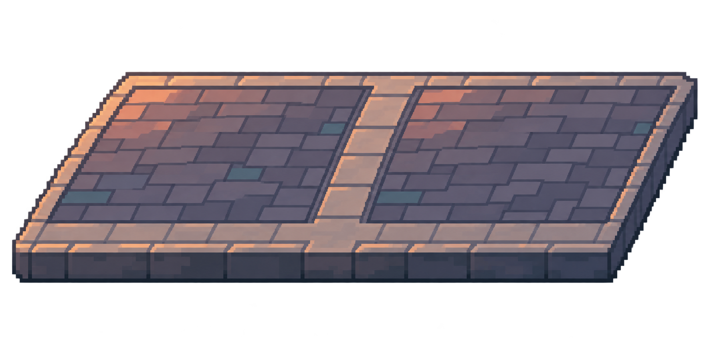 |
| 무대 | 공연자와 악기가 올라가는 뒤쪽 무대 | 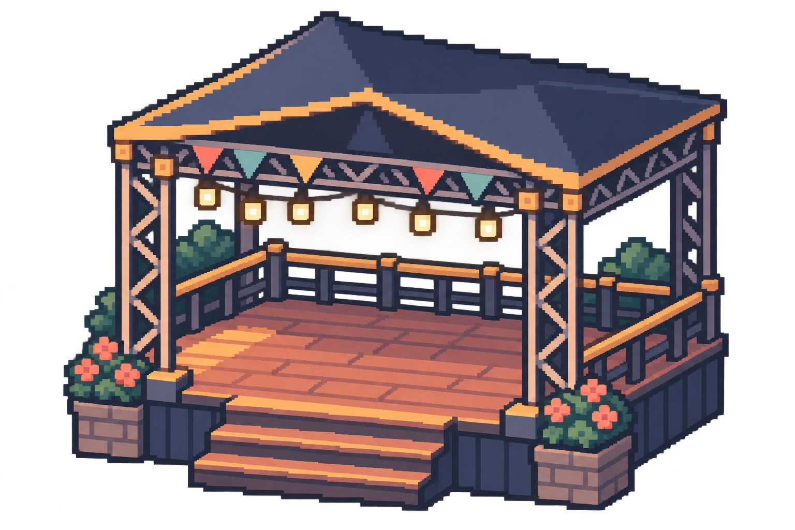 |
| 배경 장식 | 화단과 삼각 깃발로 무대 뒤 경계를 표시 |  |
| 스피커 | 무대 좌우에서 객석 방향을 보여주는 스피커 | 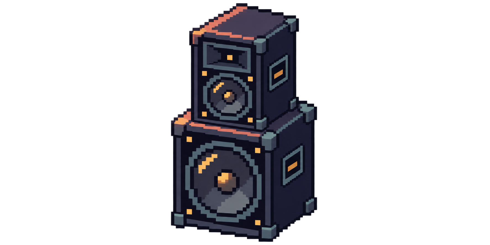 |
| 조명 | 떼창이 번지는 방향을 강조하는 조명 타워 | 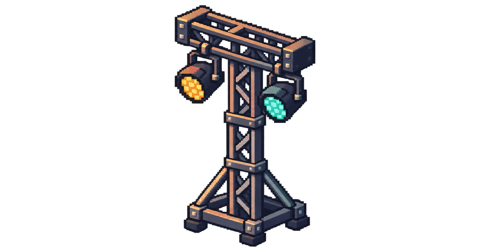 |
| 푸드트럭 | 객석 바깥에 배치하는 간식 트럭 |  |
| 발전기 | 마지막 후렴의 뒷줄 소음 상태를 예고하는 발전기 | 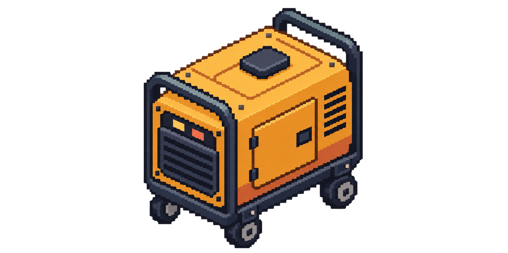 |

7종은 개별 투명 PNG로 보관해요. 인게임에 적용할 때 바닥 → 배경 장식·무대 → 스피커·조명 → 관객과 전경 소품 순으로 겹쳐 배치해요. 조명 변화와 발전기의 작동·정지 표시는 게임 화면에서 별도로 연출해요. 현재 원본은 아트 시안이며, 실제 화면 배치에서 오브젝트의 상대 크기와 접지점을 맞춰요.

## 24. 동네 축제 관객 스프라이트

관객 기본 도트는 몸통 2종과 머리·모자 4종으로 구성해요. 앞줄과 뒷줄에 같은 파츠를 사용하고, 실제 배치에서는 목 접점과 발 기준선을 맞춘 뒤 조합과 반복 시작 시점을 달리해요.

| 기본 도트 | 이미지 |
|---|---|
| 청록 점퍼 몸통 |  |
| 코럴 스웨터 몸통 |  |
| 짧은 머리 |  |
| 단발 |  |
| 호박색 캡 |  |
| 청록 비니 |  |

### 공용 동작 5개

동작별 PNG에는 왼쪽부터 오른쪽으로 읽는 **4개 키프레임**이 있어요. 각 이미지는 **2172×724px**, 각 프레임 셀은 **543×724px**예요. 프레임 번호는 0부터 시작하며 박수·떼창은 120 BPM에서 4프레임을 한 박에 재생하는 초기값으로 잡아요.

| 동작 | 화면에서 읽히는 신호 | 초기 재생 규칙 | 스프라이트 시트 |
|---|---|---|---|
| 기본 대기 | 몸이 가볍게 들썩여요 | 125ms × 4, 반복 | 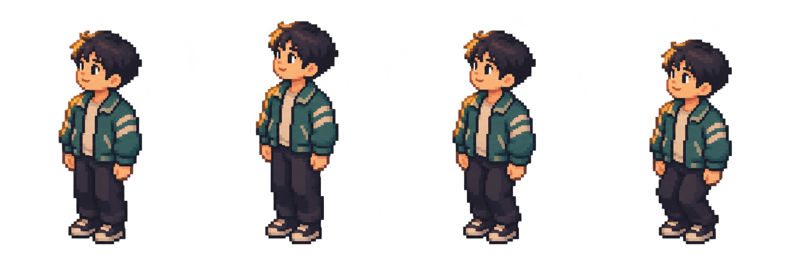 |
| 귀 기울이기 | 한 손을 귀에 대고 몸을 앞으로 기울여요 | 0→1→2, 2번 유지 후 3번으로 해제 | 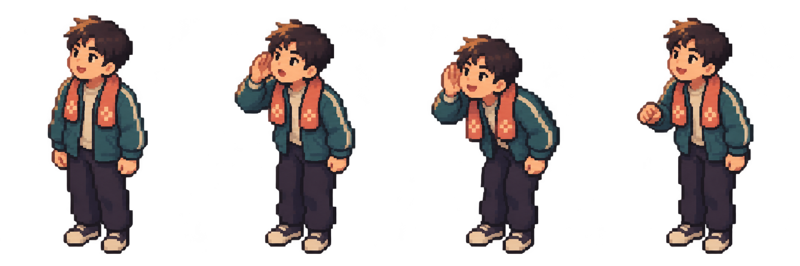 |
| 박수 | 가슴 앞에서 손을 모았다 펴요 | 125ms × 4, 반복 | 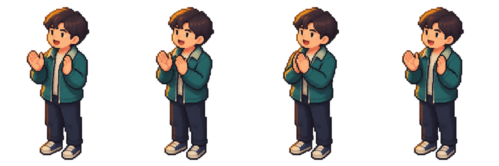 |
| 떼창 | 입을 열고 두 손을 위로 들어요 | 125ms × 4, 합류 박부터 반복 | 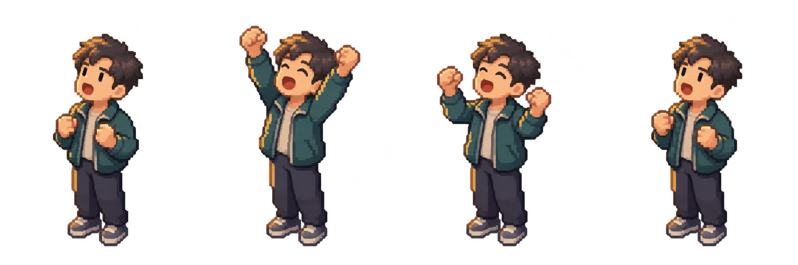 |
| 귀 막기 | 두 손으로 귀를 덮고 몸을 움츠려요 | 0→1→2, 2번 유지 후 3번으로 해제 | 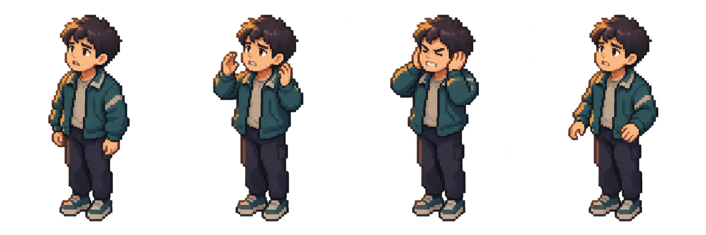 |

공용 동작은 청록 점퍼 관객의 전신 스프라이트 시안이에요. 다른 몸통·머리 조합으로 같은 동작을 재생하려면 구현 단계에서 부위별 프레임과 목 접점, 발 기준선을 맞춰야 해요. 공연 화면에서는 후렴 신호가 실행된 박에 떼창 동작을 시작하고, 귀 기울이기와 귀 막기는 카드의 ‘작음’과 ‘큼’ 표시와 일치시켜요.

## 25. 동네 축제 무대 캐릭터

| 캐릭터 | 배치 | 기본 도트 |
|---|---|---|
| 보컬 | 무대 앞 중앙. 평소에는 노래하고, 신호가 예약되면 마이크로 관객의 응답을 유도해요. | 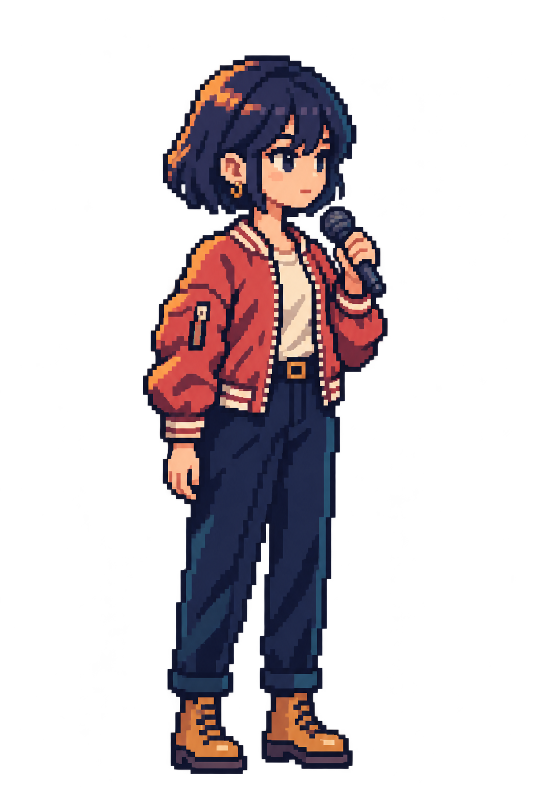 |
| 기타 연주자 | 무대 뒤쪽. 반주에 맞춰 반복해서 기타를 쳐요. | 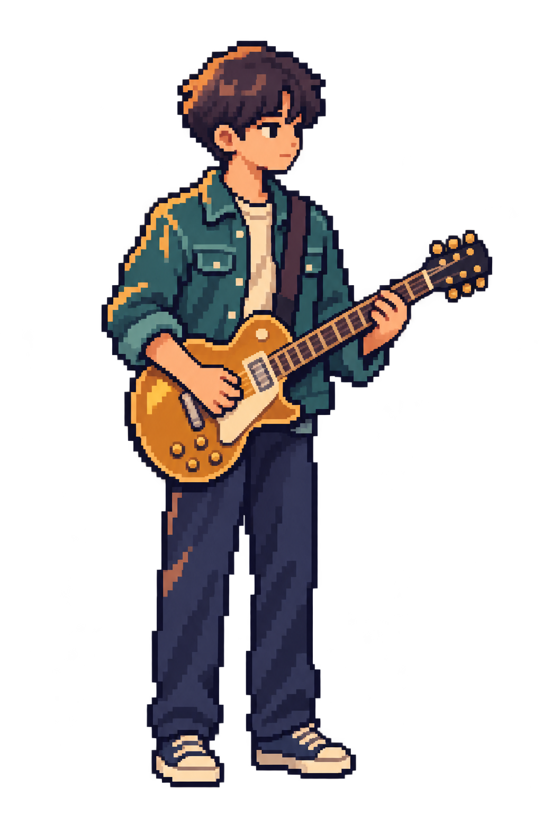 |
| 푸드트럭 사장님 | 객석 외곽, 푸드트럭 옆. 양쪽 떼창이 이어지면 집게로 박자를 맞춰요. |  |

### 캐릭터 동작 4개

스프라이트 시트는 투명 PNG 2172×724px이고, 각 시트는 왼쪽부터 네 개의 543×724px 프레임으로 읽어요. 120 BPM에서는 프레임당 125ms를 초기값으로 사용하면 네 프레임이 한 박이에요.

| 동작 | 재생 조건 | 스프라이트 시트 |
|---|---|---|
| 보컬 노래 | 공연 중 기본 반복 동작 | 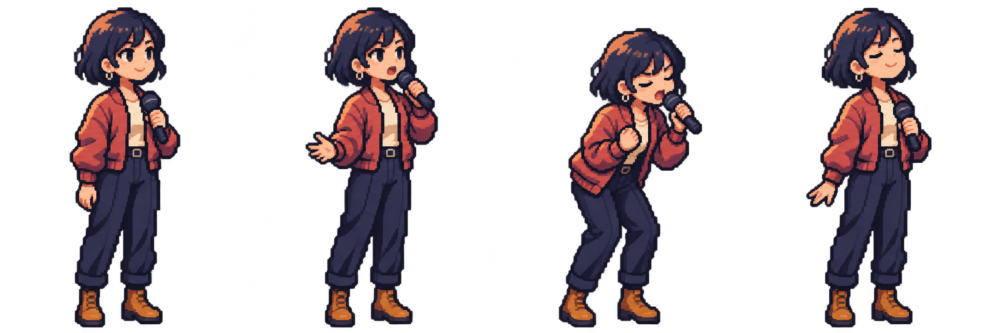 |
| 보컬 마이크 내밀기 | 신호가 예약된 박에 시작하고, 관객이 받아 부르거나 신호 구간이 닫힐 때까지 마지막 자세를 유지해요. | 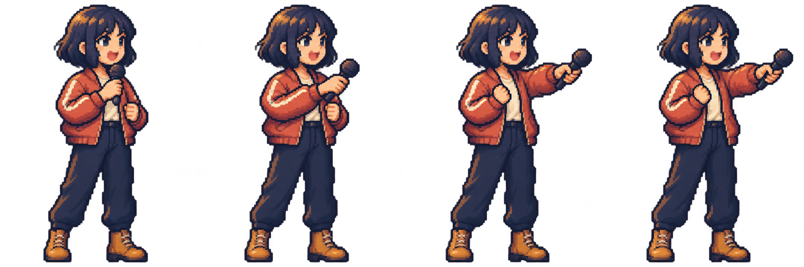 |
| 연주자 기타 연주 | 음악 재생 중 박에 맞춰 반복해요. 일시정지하면 음악과 같이 정지해요. | 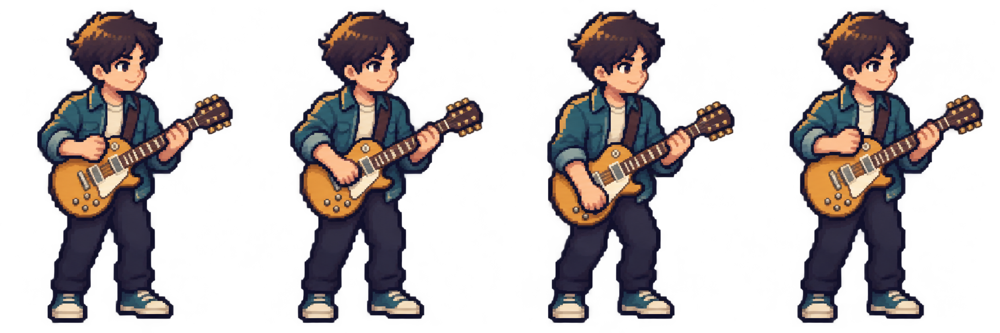 |
| 사장님 집게 박수 | 동네 축제 마지막 후렴에서 양쪽이 3초 연속으로 떼창하면 시작해요. | 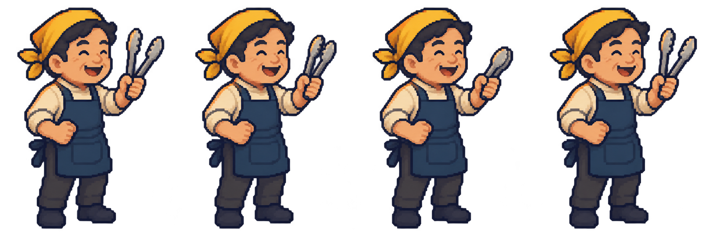 |

기본 도트와 동작 시트를 교체할 때 캐릭터마다 발 접지점과 화면 크기를 맞춰요. 보컬의 마이크 동작은 카드의 예약 표시를 보조하며, 득점과 음소거 판정은 기존 규칙을 사용해요.

## 26. 사건과 성공 효과

두 효과는 각각 투명 PNG **2172×724px**이며, 왼쪽부터 **543×724px 프레임 4개**로 읽어요. 프레임당 125ms를 초기값으로 사용해 120 BPM에서 한 박 동안 한 사이클을 재생해요.

| 효과 | 배치와 재생 조건 | 스프라이트 시트 |
|---|---|---|
| 발전기 진동 | 발전기 몸체 양옆에 진동 표시를 겹쳐요. 발전기가 돌아가는 동안 반복하고, 정지 이벤트가 실행되는 박에 진동 표시를 숨겨요. 정지 예고의 아이콘과 남은 박은 구역 카드에서 확인할 수 있어요. | 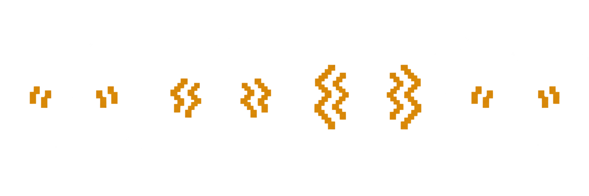 |
| 떼창 전달 조명 | 상대 구역의 실제 합류 박에 객석 바닥 위로 한 번 재생해요. 시작 구역에서 응답 구역 쪽으로 이동하도록 효과의 배치 방향을 설정하고, 마지막 프레임 뒤에 숨겨요. 관객과 구역 이름은 조명 위에 유지해요. | 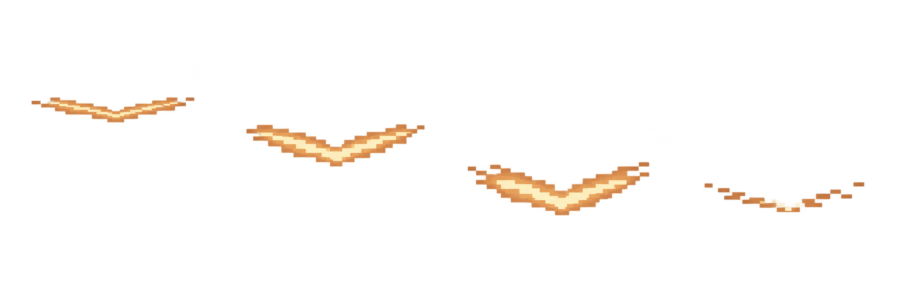 |

일시정지할 때 효과는 공연 시계와 함께 멈춰요. 진동과 조명은 사건과 득점 결과를 보여주는 시각 효과예요. 화면에서 숨기거나 음소거해도 사건 타이밍과 점수 판정은 같아요.

## 27. Flutter 조작 UI 공용 컴포넌트 7종

[공용 컴포넌트 코드](../lib/performance_controls.dart)를 사용해 앞줄·뒷줄에 같은 조작 UI를 적용해요. 앱을 실행하면 [조작 미리보기](../lib/main.dart)에서 두 구역 볼륨을 직접 바꾸고 신호 예약 상태를 확인할 수 있어요.

| 컴포넌트 | 표시와 입력 |
|---|---|
| 구역 카드 | 구역 이름, 상태, 볼륨, 신호 버튼을 같은 위치에 모아요. 두 카드가 들어가기 어려운 화면과 큰 글자 설정에서는 세로로 배치해요. |
| 볼륨 슬라이더 | 0–100 값을 탭이나 가로 드래그로 바꿔요. 48 논리 픽셀 높이의 터치 영역을 쓰고 스크린 리더에 현재 값과 증감 동작을 제공해요. |
| 신호 버튼 | 대기, 입력 가능, 다음 박 시작, 받아 부를 차례 상태를 보여줘요. 입력 가능 상태에서만 동작해 같은 신호를 다시 눌러 예약할 수 없어요. |
| 박자 띠 | 남은 박을 막대와 숫자로 함께 표시해요. |
| 관객 상태 배지 | 작음, 준비, 큼, 떼창을 각각 기호와 문구로 구분해요. |
| 사건 예고 | 어떤 사건이 몇 박 후에 일어나는지 문장으로 표시해요. |
| 공연 점수 | 현재 점수와 만점을 함께 표시해요. |

미리보기에서 슬라이더 값은 두 구역에 함께 영향을 주고, 한쪽의 신호를 누르면 해당 카드에 ‘다음 박 시작’, 상대 카드에 ‘받아 부를 차례’가 표시돼요. 미리보기의 남은 박, 예고, 점수는 표시용 값이에요. 실제 공연 시계와 연결할 때 각 값을 공연 판정 결과로 전달해요.

## 28. Flutter 화면 6종과 일시정지 팝업

[화면 미리보기 구현](../lib/main.dart)에서 동네 축제 아트와 공용 조작 UI를 사용해 첫 실행부터 후렴 재도전까지 연결해요.

| 화면 | 미리보기에서 확인할 동작 |
|---|---|
| 시작 | ‘공연 시작’으로 공연 선택을 열고 ‘설정’으로 화면을 이동해요. |
| 공연 선택 | 동네 축제의 무대와 공연 길이, 후렴 수를 보고 공연을 시작해요. |
| 공연 | 앞줄·뒷줄 볼륨을 조절하고 신호를 한 번 예약해요. 상단의 일시정지 버튼이나 하단의 ‘예시 결과 보기’를 눌러요. 후렴 연습도 이 화면을 재사용해요. |
| 전체 결과 | 예시 총점과 세 후렴 점수를 확인하고, 연습할 후렴을 고르거나 전체 공연을 다시 시작해요. |
| 후렴 연습 결과 | 이전과 이번 예시 점수를 비교하고, 같은 후렴을 다시 연습하거나 원래 전체 결과로 돌아가요. |
| 설정 | 게임 볼륨과 진동을 바꾸고 시작 화면으로 돌아가요. 설정은 미리보기가 실행되는 동안 유지해요. |

**일시정지 팝업.** ‘이어 하기’는 현재 볼륨과 신호 예약을 유지해요. ‘처음부터 다시’는 미리보기 조작 상태를 초기화해요. 나가기 동작은 일반 공연에서는 공연 선택, 후렴 연습에서는 전체 결과로 돌아가요.

이 버전은 화면과 이동을 검증하는 미리보기예요. 결과 점수와 남은 박은 예시 값이고, 설정은 앱을 다시 열면 초기값으로 돌아와요. 실제 공연 시계, 기록 저장, 음량과 진동을 기기 재생에 적용하는 작업은 게임 구현에서 연결해요.

## 29. 남은 UX/UI 작업 순서와 완료 기준

동네 축제 첫 버전은 기존 화면 6개, 일시정지 팝업 1개, 조작 컴포넌트 7개를 재사용해요. 새 화면 제작 수량은 0개예요. 아래 순서는 장면에서 정보를 읽을 수 있는지 확인한 뒤 실제 공연 판정, 결과, 기기 저장을 연결하도록 잡았어요.

### 1단계 · 2.5D 공연 장면 1종과 효과 2종 배치

- [ ] 기존 바닥·무대 위에 공연자, 앞줄·뒷줄 관객, 푸드트럭과 발전기를 배치해요. 앞줄·뒷줄에는 조작 카드와 동일한 이름과 아이콘을 표시해요.
- [ ] 발전기 진동은 가동 구간에만 반복하고, 떼창 조명은 상대 구역이 합류할 때 시작 구역에서 응답 구역으로 한 번 재생해요. 실제 판정 연결 전에는 미리보기 상태로 배치를 확인해요.
- **완료 기준** — 리허설, 앞줄 신호 예약, 양쪽 떼창 세 장면에서 소리를 끈 상태로도 지금 노래하는 구역과 다음에 조작할 카드를 구분할 수 있어요.

### 2단계 · 실시간 조작 피드백 5종 연결

1. **남은 박**을 공연 시계에 연결해 신호 가능 시간과 다음 박을 표시해요.
2. **관객 상태**를 실제 체감 볼륨과 떼창 판정에 연결해요. 카드의 상태와 객석 자세가 함께 바뀌어야 해요.
3. **신호 예약·응답**을 연결해 시작 카드에는 ‘다음 박 시작’, 실제로 합류할 수 있을 때 상대 카드에는 ‘받아 부를 차례’를 표시해요.
4. **사건 예고**를 타임라인에 연결해 발전기가 켜지고 꺼지는 시점, 영향받는 구역, 남은 박을 표시해요. 1단계의 효과 두 종도 여기서 실제 판정에 연결해요.
5. **실시간 점수**를 후렴 득점 판정에 연결해요. 일시정지 중에는 모든 박 표시, 효과, 사건, 점수가 멈춰야 해요.

**완료 기준** — 동일한 입력을 사용하면 소리 켬·끔 모두 같은 박에 사건과 떼창이 실행되고 같은 점수가 나와요. 신호를 놓쳐도 일반 떼창에 합류할 수 있는 상태가 화면에 표시돼요.

### 3단계 · 결과 화면 2개와 후렴 상태 복원 1개 연결

- [ ] **전체 결과**에 실제 공연 점수와 후렴별 시작 구역, 상대 구역 합류 박, 동시 떼창 시간을 표시해요.
- [ ] **후렴 연습 결과**에 같은 후렴의 직전 시도와 이번 기록을 나란히 표시해요. 같은 후렴 재연습과 전체 결과 복귀를 연결해요.
- [ ] **후렴 상태 복원**을 구현해 20절과 21절의 후렴별 시작 시점, 당시 볼륨, 사건 조건을 불러와 해당 후렴만 다시 진행해요.
- **완료 기준** — 전체 결과에서 마지막 후렴을 한 번 누르면 74초 조건으로 돌아가요. 연습을 끝내도 직전 전체 공연 점수와 해금 상태는 그대로예요.

### 4단계 · 설정과 기록 4종 저장

| 저장 항목 | 적용 시점 |
|---|---|
| 음량 | 변경 즉시 기기 로컬에 저장하고 게임 오디오에 반영해요. |
| 진동 | 변경 즉시 기기 로컬에 저장하고 신호 피드백에 반영해요. |
| 일반 공연 최고 기록 | 전체 공연 종료 시 저장해요. 완주 여부와 최고 기록에 해당하는 후렴 결과도 이 기록에 함께 보관해요. |
| 숙련 후렴 최고 기록 | 숙련 배치의 연습 종료 시 일반 공연과 별도로 저장해요. |

**완료 기준** — 비행기 모드에서 설정을 바꾸고 일반 공연과 숙련 후렴을 끝낸 뒤 앱을 다시 열어도 설정과 확정 기록을 불러올 수 있어요.

### 5단계 · iOS·Android 각각 4개 시나리오 검수

| 시나리오 | 통과 조건 |
|---|---|
| 작은 화면 조작 | 화면 양쪽의 슬라이더와 ‘라우럴!’ 버튼을 따로 누를 수 있고, 객석과 조작 카드 사이의 구역 표시를 확인할 수 있어요. |
| 큰 글자 | 상태 문구, 버튼, 점수가 잘리지 않고 스크롤로 필요한 조작에 닿을 수 있어요. |
| 무음 플레이 | 소리와 진동을 끈 상태에서 사건 예고, 신호 예약, 상대 구역 합류를 읽고 공연부터 재도전까지 진행할 수 있어요. |
| 일시정지·복귀 | 팝업과 백그라운드 전환 후 이어 하면 볼륨·예약·점수가 유지되고 음악과 다음 박을 같은 지점에서 재개해요. |

총 검수 건수는 **2개 플랫폼 × 4개 시나리오 = 8건**이에요. 수정이 필요하면 해당 시나리오를 다시 검수한 뒤 완료로 표시해요.

## 30. 동네 축제 UX/UI 디자인 시안

### 공연 화면 3개 상태

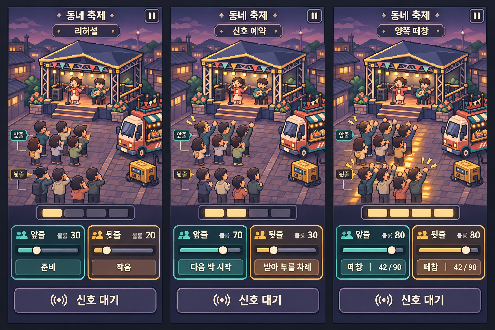

위에서부터 무대, 앞줄과 뒷줄, 박자 띠, 구역별 조작 카드 순으로 배치해요. 앞줄은 청록색, 뒷줄은 호박색으로 연결하고 구역 이름을 객석과 카드에 모두 표시해요. 왼쪽 시안은 박수와 귀 기울이기, 가운데는 앞줄 예약과 뒷줄 응답 안내, 오른쪽은 양쪽 관객의 손동작과 바닥 조명으로 떼창 전달을 보여줘요.

### 전체 결과와 후렴 연습 결과

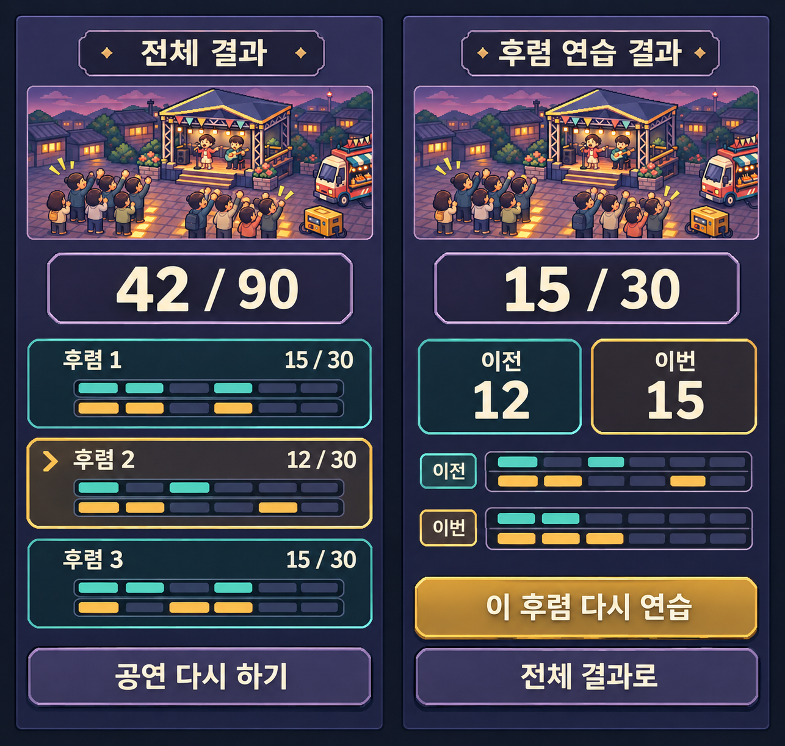

전체 결과는 위에서 공연 총점을 보여주고, 후렴마다 두 구역의 떼창 타임라인을 한 줄에 배치해요. 후렴을 선택하면 같은 구간을 다시 연습할 수 있고, 연습 결과에서는 이전 시도와 이번 시도의 점수와 타임라인을 같은 순서로 비교해요.

이미지의 점수와 슬라이더 값은 화면 구성용 예시예요. 구현에서는 신호 버튼을 구역별 카드 안에 배치하고, 화면 하단의 별도 신호 대기 버튼과 카드 안의 반복 총점은 제외해요. 정확한 버튼 문구, 상태와 판정은 17절, 20절, 29절의 명세를 적용해요.

## 31. 구현된 2.5D 공연 장면과 효과

[공연 장면 구현](../lib/festival_scene.dart)은 동네 축제 장면 1종을 구성해요. 고정 시점에서 바닥 위에 무대와 소품, 보컬과 기타 연주자, 앞줄·뒷줄 관객, 푸드트럭과 발전기를 겹쳐 그려요. 관객은 각 카드와 같은 구역 이름으로 표시하고, 볼륨 상태에 따라 귀 기울이기, 박수, 귀 막기, 떼창 스프라이트를 전환해요.

- **발전기 진동 효과.** 발전기가 작동하는 동안 네 프레임을 반복해요. 미리보기에서 신호가 실행된 뒤 두 박이 지나면 발전기가 멈추고 진동 표시가 사라져요.
- **떼창 전달 조명.** 시작 구역 이후 상대 구역이 떼창에 합류한 박에 한 번만 재생해요. 먼저 노래한 구역에 따라 이동 방향이 바뀌고, 관객 발밑에 표시해요.
- **미리보기 사용.** ‘공연 시작 → 동네 축제 시작’으로 이동해 두 카드가 모두 ‘준비’가 되도록 볼륨을 조절한 뒤 한쪽 ‘라우럴!’을 눌러요. 일시정지 팝업을 열거나 앱을 백그라운드로 보내면 애니메이션이 멈춰요.

이 장면은 미리보기의 박과 상태에 연결했어요. 전체 100초 공연 타임라인, 실제 음원, 결과 득점과 기록 저장은 첫 플레이 가능 버전 제작 명세에 따라 후속으로 연결해요.

## 32. 구현된 실시간 조작 피드백 5종

[공연 상태 모델](../lib/festival_performance.dart)이 동네 축제 100초 타임라인을 120 BPM으로 진행해요. 관객, 조작 카드, 두 효과와 점수가 같은 공연 시계를 사용해요.

| 피드백 | 실행 규칙 |
|---|---|
| 남은 박 | 신호를 보낼 수 있을 때 남은 박을 표시하고 예약 후에는 신호 예약 상태와 실행까지 남은 박을 안내해요. 마지막 후렴은 발전기 정지를 기다릴 수 있도록 78초부터 81초 직전까지 입력을 받아요. |
| 관객 상태 | 구역 간 소리 전달과 관객 접근·발전기 보정을 적용해 작음, 준비, 큼, 떼창을 보여줘요. 객석 애니메이션과 카드가 같은 상태를 사용해요. |
| 신호 예약·응답 | 후렴당 한 번 구역을 선택해 신호를 예약해요. 준비된 시작 구역이 두 박을 유지하면 상대도 합류할 수 있어요. 신호를 놓치면 후렴 시작 3초 뒤 일반 떼창으로 회복할 수 있어요. |
| 사건 예고 | 앞줄 관객 접근과 발전기 가동·정지를 박으로 예고해요. 발전기 진동과 뒷줄 소음은 타임라인에 따라 함께 멈춰요. |
| 공연 점수 | 후렴의 득점 구간에서 부르는 구역마다 **한 박당 0.5점**을 더하고, 두 구역이 함께 부르면 0.5점을 추가해요. 공연은 90점, 한 후렴 연습은 30점 만점이에요. |

공연 종료 뒤 ‘결과 보기’에서 실제로 계산된 총점과 후렴별 점수를 확인해요. 후렴 연습은 현재 각 구간의 기본값에서 시작해요. 직전 공연 볼륨과 사건 상태 복원, 기기 최고 기록 저장, 숙련 배치, 음악·진동 연동은 후속 구현 항목이에요. 일시정지와 백그라운드 전환 동안 공연 시계와 득점을 멈춰요.

## 33. 결과 화면, 후렴 복원과 기기 저장

**전체 결과**의 후렴마다 실제 시작 구역, 합류 박, 동시 떼창 시간과 구역별 타임라인을 표시해요. **후렴 연습 결과**는 이전과 이번 점수 및 타임라인을 비교하고, 같은 후렴을 다시 열거나 직전 전체 결과로 돌아갈 수 있어요.

공연은 **20초·46초·74초**에 각 후렴의 볼륨과 판정 상태를 보관해요. 선택한 후렴에서 해당 시점과 상태를 재사용해 사건 예고와 발생 시점도 같은 공연 시계로 재현해요. 연습 점수는 0에서 시작하고, 전체 공연 결과 및 체크포인트를 변경하지 않아요.

| 기기 저장 항목 | 적용 |
|---|---|
| 게임 음량 | 설정 변경 시 저장하고 앱 재실행 시 값을 불러와요. 이 버전은 공연 음악이 포함되어 있지 않아 음량에 따른 음악 재생은 후속 연동 범위예요. |
| 진동 | 설정 변경 시 저장하고 신호 예약의 촉각 피드백에 반영해요. |
| 일반 공연 최고 기록 | 공연 완주 직후 최고점과 해당 공연의 마지막 후렴 체크포인트를 함께 저장해요. |
| 숙련 후렴 최고 기록 | 일반 공연을 한 번 완주하면 공연 선택에서 숙련 후렴을 열어요. 일반 공연 최고 기록의 체크포인트를 사용하고, 발전기 정지를 두 박 늦춘 구간의 최고점을 따로 저장해요. |

기기 기록은 로컬에 보관해요. 일반 후렴 연습은 일반 공연이나 숙련 후렴의 최고점을 변경하지 않아요.

## 34. 플랫폼 검수

[실기기 검수표](device-qa.md)에 대상과 통과 기준을 기록해요. iOS·Android에서 각각 작은 세로 화면, 큰 글자, 무음·오프라인, 일시정지·복귀 시나리오를 검사해요. Android 에뮬레이터 결과는 실기기 결과와 별도로 적어요.

## 35. 첫 버전 음원·폰트·스토어 리소스

### 공연 음원과 효과음

[동네 축제 공연곡](../assets/audio/festival-first-show.wav)은 120 BPM, 4/4박자, 100초 분량의 오리지널 픽셀 팝 반주예요. 첫 박은 파일 시작점에 있고, **24.0초·52.0초·80.0초**에는 각각 후렴 멜로디와 타격음이 함께 시작해요. 44.1kHz, 16bit PCM WAV로 앱 번들에 포함해요.

| 효과음 | 길이 | 재생 지점 |
|---|---:|---|
| [라우럴! 음성](../assets/audio/sfx/laureol-call.wav) | 0.78초 | 신호 실행 박. 한국어 합성 음성으로 제작했어요. |
| [관객 박수](../assets/audio/sfx/crowd-clap.wav) | 0.85초 | 관객이 준비를 마쳤을 때 짧게 재생해요. |
| [관객 떼창](../assets/audio/sfx/crowd-singalong.wav) | 2.05초 | 상대 구역이 합류한 박에 재생해요. |
| [발전기 작동](../assets/audio/sfx/generator-loop.wav) | 2.00초 | 발전기 가동 구간에서 반복해요. |
| [발전기 정지](../assets/audio/sfx/generator-stop.wav) | 0.88초 | 작동 루프를 종료할 때 한 번 재생해요. |
| [결과 확인](../assets/audio/sfx/result-chime.wav) | 1.34초 | 공연 결과가 열릴 때 한 번 재생해요. |

오디오는 번들에 등록했어요. 실제 공연 재생, 음량 설정 적용, 일시정지·후렴 재도전 시 탐색 연결은 남아 있어요.

### 한글 UI 폰트

**Laureol Sans**는 Noto Sans KR을 기본으로 모든 현대 한글 완성형 음절, 자모, 숫자와 UI용 기호를 남긴 게임 전용 파생 서체예요. 일반 400과 굵게 700을 번들에 포함하고 화면과 객석 표기에 사용해요. [원본 Noto Sans KR](https://github.com/google/fonts/tree/b38c5c93af322c45f633e17ac440ec1e6c94d489/ofl/notosanskr) · [SIL OFL 라이선스](../assets/fonts/OFL.txt)

### 앱 아이콘과 스토어 이미지

- [앱 아이콘 원본](art/store/app-icon-1024.png)에서 iOS 앱 아이콘과 Android 런처 아이콘의 크기별 파일을 만들었어요. [Google Play 아이콘](art/store/play-icon-512.png)은 별도로 제공해요.
- [Google Play 대표 이미지](art/store/play-feature-1024x500.png)는 동네 축제와 관객이 떼창하는 장면을 담은 1024×500 홍보 이미지예요. [Google Play 이미지 규격](https://support.google.com/googleplay/android-developer/answer/9866151?hl=en)
- 스토어 스크린샷은 실제 Flutter 앱에서 리허설, 양쪽 떼창, 결과 화면을 캡처한 세 장이에요. iPhone은 1320×2868, Android는 1080×1920으로 내보냈어요. iPhone용 이미지는 공용 Flutter 화면을 해당 크기로 렌더링한 결과이며, iOS 실기기 캡처와 심사 제출은 별도로 진행해요. [Apple 스크린샷 규격](https://developer.apple.com/help/app-store-connect/reference/app-information/screenshot-specifications)

| 화면 | iPhone | Android |
|---|---|---|
| 공연 조작 | [리허설](art/store/iphone/01-festival.png) | [리허설](art/store/android/01-festival.png) |
| 떼창 연출 | [양쪽 떼창](art/store/iphone/02-singalong.png) | [양쪽 떼창](art/store/android/02-singalong.png) |
| 결과 | [후렴별 점수](art/store/iphone/03-results.png) | [후렴별 점수](art/store/android/03-results.png) |

## 36. 시각 디자인 개선 계획

현재 기준 화면은 31~35절의 동네 축제 구현과 스토어 캡처예요. [실기기 검수표](device-qa.md)에 기록된 Android 에뮬레이터의 320×640 화면에서는 두 구역을 조작하려면 스크롤이 필요했어요. 이번 보강 범위는 **기존 공연 화면 1개와 결과 화면 2개**예요. 공연 타임라인과 점수, 후렴 복원은 현재 규칙을 그대로 사용해요.

### 1단계 · 작은 화면에서 객석과 조작부를 함께 배치

공연 화면은 **상단 정보 → 2.5D 객석 → 사건·박자 → 앞줄·뒷줄 조작 카드** 순서로 배치해요. 320×640 **논리 픽셀**에서 기본 글자 크기를 기준으로 두 카드와 객석이 첫 화면에 들어오도록 설계해요.

| 영역 | 작은 화면 높이 목표 | 배치 규칙 |
|---|---:|---|
| 상단 정보 | 48px | 한 줄에 공연 이름, 점수, 일시정지를 배치해요. |
| 객석 | 216px 안팎 | 지붕 위 여백과 하늘을 먼저 줄이고, 앞줄·뒷줄 대표 관객 및 사건이 표시되는 발전기를 화면 안에 둬요. |
| 사건·박자 | 60px 안팎 | 사건 문구와 남은 박을 한 영역에서 보여줘요. 사건 문구 없이도 같은 공간을 유지해 카드가 움직이지 않게 해요. |
| 조작 카드 | 176px 안팎 | 두 카드를 나란히 두고 구역 이름, 상태, 슬라이더, 신호 버튼 순서를 맞춰요. 슬라이더와 버튼은 각각 48px 이상의 터치 높이를 확보해요. |

영역 사이와 바깥 여백은 합계 약 24px를 초기값으로 잡아요. 시스템 안전 영역을 제외한 높이에 맞춰 객석의 여백부터 조정해요. 시스템 글자 크기 1.8배나 더 좁은 안전 영역에서는 카드를 세로로 쌓고 스크롤을 허용해 조작 크기와 안내 문구를 유지해요. 결과 보기 버튼이 생기더라도 공연 도중의 카드 위치에는 영향을 주지 않게 배치해요.

**완료 기준** — 기본 글자 크기에서 리허설·앞줄 신호 예약·양쪽 떼창을 각각 열어 양쪽 대표 관객과 두 카드가 한 화면에 있는지 확인해요. 스크롤 없이 뒷줄 볼륨을 바꾸고 앞줄 신호를 보낼 수 있어야 해요. 사건 문구나 신호가 바뀌어도 터치할 곳이 이동하지 않아야 해요.

### 2단계 · 무음에서 관객 반응을 또렷하게 구분

각 구역에 **대표 관객 1~2명**을 조작 카드와 가까운 쪽에 배치하고, 주변 관객과 실루엣이 겹치지 않게 해요. 구역 이름과 구역 표식은 객석과 카드에 동일하게 표시해요.

| 상태 | 객석의 대표 동작 | 조작 카드 |
|---|---|---|
| 소리가 작음 | 몸을 앞으로 기울이고 한 손을 귀에 대요. | ‘작음’과 아래 화살표 |
| 볼륨이 적정 | 곧게 서서 가슴 앞에서 박수를 쳐요. | ‘준비’와 체크 |
| 소리가 큼 | 두 손으로 귀를 막고 상체를 움츠려요. | ‘큼’과 위 화살표 |
| 떼창 | 고개를 들어 입을 벌리고 양손을 위로 들어요. | ‘떼창’과 음표 |

응답 기회가 열리면 응답 구역 이름 옆에 ‘받아 부를 차례’를 보여줘요. 실제 합류 박에는 그쪽 대표 관객의 떼창 동작과 바닥 조명이 시작돼요. 발전기가 돌아갈 때는 뒷줄 카드와 발전기 옆에 변화의 원인을 보여줘요.

**완료 기준** — 소리와 진동을 끄고 화면을 비교했을 때 대표 관객의 ‘귀 기울이기’와 ‘귀 막기’를 구분할 수 있어야 해요. 색상 표시를 가려도 구역 이름, 동작, 상태 문구로 **어느 구역을 올리거나 내려야 하는지와 어느 쪽이 다음에 부르는지** 읽을 수 있어야 해요.

### 3단계 · 기존 관객 에셋으로 군중의 반복감 줄이기

몸통 2종과 머리·모자 4종을 조합해 무대 양쪽에 나눠 배치해요. 같은 머리와 몸통 조합이 서로 붙어 서지 않게 배치하고, 관객별 외형과 위치는 공연과 후렴 재도전에서 동일하게 유지해요. 먼저 대표 관객 2명으로 머리 파츠를 붙이는 프레임의 목 접점과 발 기준선을 맞춰요. 그다음 두 몸통이 상태별 동작에서도 유지되도록 공유 동작에 맞춰 팔·상체 프레임을 정리해요.

대기와 박수는 관객마다 시작 프레임을 0~3프레임 사이에서 엇갈리게 해요. 떼창에 합류하는 첫 손동작은 해당 구역이 합류한 박에 함께 시작해요. 대표 관객의 동작을 주변 인원이나 푸드트럭 연출이 가리지 않게 해요.

**완료 기준** — 일반 플레이 캡처에서 두 구역 모두 서로 다른 머리나 옷이 보이고 관객 전체가 같은 박에 반복적으로 움직이지 않아야 해요. 떼창 합류 장면에서는 같은 구역의 첫 동작이 실제 득점 시작 박과 일치해야 해요.

### 4단계 · 결과에서 다시 연습할 구간을 바로 찾게 하기

전체 결과의 후렴 세 줄은 공연 순서대로 유지해요. 한 구역이 끝까지 합류하지 못한 후렴을 먼저 추천해요. 그중 점수가 가장 낮은 후렴을 고르고, 동점이면 먼저 나온 후렴을 고릅니다. 전부 합류했다면 두 구역의 첫 합류 박 차이가 가장 큰 후렴을 추천해요. 박 차이가 같으면 앞선 후렴을 선택해요. 모든 후렴에서 두 구역이 같은 박에 시작했다면 추천 표시 없이 각 후렴의 연습 버튼을 보여줘요.

선택된 후렴 한 곳에만 권장 표시와 비교 문구를 붙여요. 예시는 **‘뒷줄 미합류’**, **‘뒷줄이 2박 뒤에 합류’**예요. 문구는 기록된 구역의 첫 합류 박을 비교해 만들어요. 타임라인에서 두 구역의 첫 합류 지점을 표시하고, 같은 줄에서 **‘이 후렴 다시 연습’**을 누르면 기존 후렴 복원 시점인 20초·46초·74초 중 해당 시점으로 돌아가요. 연습 결과에는 이전과 이번 타임라인의 축과 구역 순서를 맞추고, 동시 떼창 시간이 늘거나 줄었으면 차이를 표시해요.

**완료 기준** — 앞줄만 부른 경우, 뒷줄이 늦게 들어온 경우, 양쪽이 동시에 들어온 경우에 화면 문구와 타임라인이 실제 기록에 맞아야 해요. 추천 후렴에서 한 번의 탭으로 기존 조건을 복원해 연습을 열고, 연습 뒤에도 전체 공연 점수는 유지돼야 해요.

### 검증 순서

1. **레이아웃.** Android 320×640 에뮬레이터에서 기본 글자와 1.8배 글자로 각 상태를 캡처해 개선 전후를 비교해요. iOS에서도 같은 논리 크기의 화면이나 이용 가능한 작은 기기에서 같은 절차를 확인해요.
2. **상태·애니메이션.** 무음으로 앞줄 시작과 뒷줄 시작을 각각 재현하고, 시작 구역·응답 구역·합류 박을 객석과 카드에서 대조해요.
3. **결과·재도전.** 위 세 가지 결과 기록을 검증하고, 추천 후렴을 눌러 기존 볼륨과 사건 시점이 복원되는지 확인해요.
4. **확정 평가.** 확인된 기기와 화면 크기, 글자 설정, 캡처를 실기기 검수표에 남겨요. 통과한 개선 항목만 구현 평가에 반영해요.

## 37. 시각 디자인 재평가

| 항목 | 개선 전 구현 | 개선안 목표 | 차이를 만드는 변경 |
|---|---:|---:|---|
| 2.5D 도트 아트와 분위기 | 19/20 | 19/20 | 기존 동네 축제 아트와 색감을 유지해요. |
| 플레이 상태의 가독성 | 18/20 | 20/20 | 대표 관객의 자세로 현재 상태를 구분하고, 결과에서는 합류가 늦거나 비었던 구간을 찾아볼 수 있어요. |
| 화면 구성과 한글 타이포그래피 | 18/20 | 20/20 | 기본 글자 크기의 320×640 화면에서 객석과 양쪽 조작부를 한 화면에 배치해요. |
| 애니메이션과 성공 연출 | 18/20 | 19/20 | 관객 외형과 평상시 동작을 다양화하고, 떼창 합류는 같은 박에 보여줘요. |
| 앱 아이콘과 스토어 이미지 | 19/20 | 19/20 | 현재 아이콘과 스토어 구성의 평가를 유지해요. 공연 화면을 바꾸면 해당 캡처를 갱신해요. |
| **합계** | **92/100** | **97/100** | 97점은 개선안 기준이며 구현 후 다시 평가해요. |

이 점수는 시각 디자인에 한정해요. 앞서 매긴 UX/UI 설계 점수 97점과는 다른 평가예요. **개선 전 구현은 92점**, 시각 디자인 목표는 **97점**이에요. 적용한 결과는 38절에서 평가해요.

## 38. 시각 디자인 개선 적용 결과와 재평가

36절의 개선 순서는 **작은 화면 배치 → 관객 상태 표식 → 군중 배치 → 결과와 재도전**으로 적용했어요. 공연 시간과 신호·득점 판정, 후렴 복원 조건은 기존 구현을 사용해요.

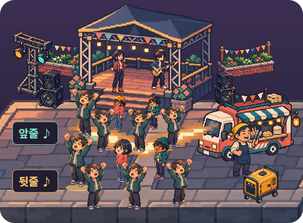

위 이미지는 양쪽 떼창 상태의 객석 위젯을 296 논리 픽셀 너비로 렌더링한 화면이에요. 공연 전체의 터치 영역과 배치는 별도 위젯 테스트에서 확인했어요.

| 순서 | 적용한 변경 | 확인한 범위 |
|---|---|---|
| 1. 작은 화면 배치 | 기본 글자 크기에서는 안전 영역을 제외한 너비와 높이에 맞춰 객석과 사건 안내를 조정해요. 가로 화면에 공간이 충분하면 무대와 조작 카드를 나란히 표시해요. 공연이 끝나면 결과 보기 버튼을 안전 영역 안쪽 하단에 고정해요. | 320×640 논리 픽셀의 신호 예약과 떼창, 390×740 세로와 852×393 가로의 iOS 안전 영역에서 양쪽 카드와 결과 버튼을 스크롤 없이 확인했어요. 큰 글자 1.8배에서는 세로 배치와 스크롤로 뒷줄 조작에 접근할 수 있었어요. |
| 2. 관객 상태 표식 | 구역별로 대표 관객을 크게 그리고 바닥 표식을 달았어요. 객석 구역 이름 옆의 화살표·체크·음표는 조작 카드의 같은 상태 기호를 사용해요. | 위젯 테스트에서 시작 구역 예약, 양쪽 떼창 상태, 조명 전달이 기존 타임라인에 맞는지 확인했어요. 사람이 작은 실기기에서 소리와 진동을 끄고 상태를 읽는 검수는 남아 있어요. |
| 3. 군중 배치 | 두 몸통과 네 머리·모자 에셋을 양쪽 객석에 나눠 배치했어요. 일반 동작에 프레임 차이를 주고, 앞쪽의 애니메이션 관객은 떼창 합류 박에서 같은 손동작을 시작해요. | 조합형 배경 관객은 몸통과 머리가 함께 들썩이는 방식이에요. 이들도 귀 막기와 떼창 같은 동작마다 별도의 팔 자세를 갖도록 맞추는 작업은 남아 있어요. |
| 4. 결과·재도전 안내 | 두 구역의 첫 합류 박을 기준으로 추천 후렴 하나를 강조하고, 미합류나 몇 박 뒤에 합류했는지 보여줘요. 이전·이번 타임라인에는 첫 합류 지점과 동시 떼창 시간 차이를 표시해요. | 위젯 테스트에서 앞줄이 합류하지 못한 후렴 2가 추천되고, 선택 시 해당 후렴 직전 볼륨이 복원되며 연습을 마쳐도 전체 공연 결과가 유지되는지 확인했어요. |

| 평가 항목 | 개선 전 | 이번 구현 평가 | 목표 |
|---|---:|---:|---:|
| 2.5D 도트 아트와 분위기 | 19/20 | 19/20 | 19/20 |
| 플레이 상태의 가독성 | 18/20 | 20/20 | 20/20 |
| 화면 구성과 한글 타이포그래피 | 18/20 | 20/20 | 20/20 |
| 애니메이션과 성공 연출 | 18/20 | 18/20 | 19/20 |
| 앱 아이콘과 스토어 이미지 | 19/20 | 19/20 | 19/20 |
| **합계** | **92/100** | **96/100** | **97/100** |

96점은 이번 구현과 위젯 테스트를 기준으로 한 잠정 시각 평가예요. Android APK가 빌드됐어요. 연결된 에뮬레이터가 내부 저장공간 부족으로 새 APK 설치를 거절해, 업데이트 화면의 iOS·Android 실기기 검수는 남아 있어요. 97점 평가를 위해 남은 작업은 조합형 관객의 상태별 동작을 완성하고, 작은 화면에서 대표 관객과 군중의 떼창 시점이 의도대로 읽히는지 검수하는 것이에요.

## 39. 관객 동작 마감과 공연 오디오 적용

| 순서 | 적용 내용 | 확인한 범위 |
|---|---|---|
| 1. 배경 관객 자세 | 주황 모자·코럴 스웨터와 청록 비니·청록 점퍼의 귀 막기 및 떼창 스프라이트를 각각 4프레임으로 만들었어요. 앞줄과 뒷줄의 배경 관객이 상태 전환 시 같은 의상과 발 위치를 유지하며 해당 동작으로 바뀌어요. | 대표 관객과 배경 관객이 같은 구역 상태를 사용해요. 일반 동작 프레임은 엇갈리고 떼창 첫 프레임은 구역의 합류 박에 맞춰요. |
| 2. 작은 화면 검수 | Android 15 에뮬레이터를 320×640으로 설정하고 게임 소리 없이 앞줄 볼륨을 높여 귀 막기를 확인했어요. 다음 공연에서는 두 슬라이더를 맞춰 앞줄부터 신호를 보낸 뒤 양쪽 떼창을 확인했어요. | 아래 두 캡처에서 객석과 두 조작 카드가 함께 보이고, 구역 문구와 관객 자세가 서로 일치해요. |
| 3. 공연 오디오 | 100초 공연곡과 효과음 6종을 앱의 공연 시계에 연결했어요. 앱에 저장된 게임 음량을 사용하고, 음량 0이면 오디오 플레이어를 만들지 않아요. | 공연 규칙 테스트에서 24초 신호, 25초 응답, 79.5초 발전기 정지, 마지막 후렴의 74초 시작 위치를 검증했어요. |

[320×640 귀 막기 캡처](art/ui/compact-crowd-cover-ears.png) · [320×640 양쪽 떼창 캡처](art/ui/compact-crowd-singalong.png)

### 재생 동작

- 공연곡은 **0초**의 첫 박부터 시작해요. 후렴 연습은 선택한 체크포인트의 **20초·46초·74초** 오프셋으로 이동한 뒤 시작해요. 일시정지나 백그라운드 진입 시 공연 시계와 오디오가 함께 멈추고, 이어 하기에서는 판정 시각으로 다시 맞춘 뒤 재생해요.
- 한국어 ‘라우럴!’과 떼창 효과음은 예약이나 애니메이션 입력 시점에 앞서 나오지 않아요. 각각 실제 신호 실행 박과 두 구역의 합류 박에 나요. 관객 박수, 발전기 반복음·정지음, 결과 확인음도 연결했어요. 일시정지 이전의 짧은 효과음은 복귀할 때 반복하지 않아요.
- 재생 중 2초마다 음악 위치와 공연 시계를 비교하고 차이가 200ms를 넘으면 공연 위치로 다시 맞춰요. 오디오 준비가 지연돼도 무음으로 공연을 계속할 수 있어요.

별도 Android 15 에뮬레이터에 오디오 빌드를 설치해 재생 → 일시정지 → 이어 하기에서 시스템 오디오 트랙이 켜짐 → 멈춤 → 켜짐으로 바뀌는 걸 확인했어요. 마지막 후렴의 숙련 도전을 열었을 때 발전기 예고가 나오는 74초 구간으로 복원되고 오디오 트랙이 다시 재생됐어요. 원음 파형과 화면의 지연을 실기기에서 계측하는 검증은 남아 있어요.

**시각 디자인 재평가** — 기존 96점에서 애니메이션 항목을 18점에서 19점으로 올려 **97/100점**으로 평가해요. 이번 점수는 Android 320×640 에뮬레이터에서 확인한 시각 기준이에요. iOS 실기기와 다양한 화면 크기에서의 최종 검수는 별도예요.
